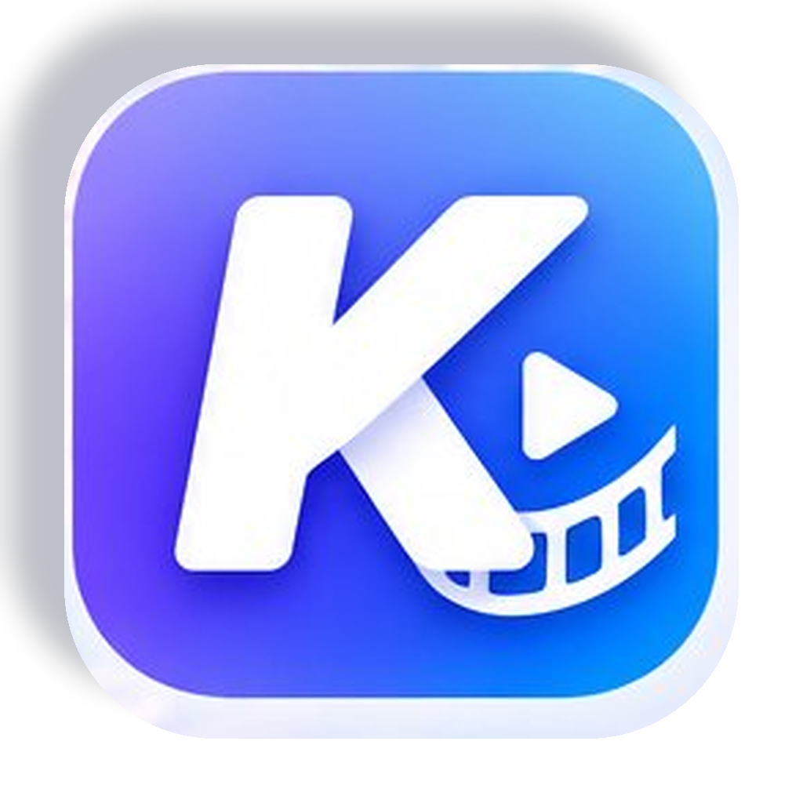
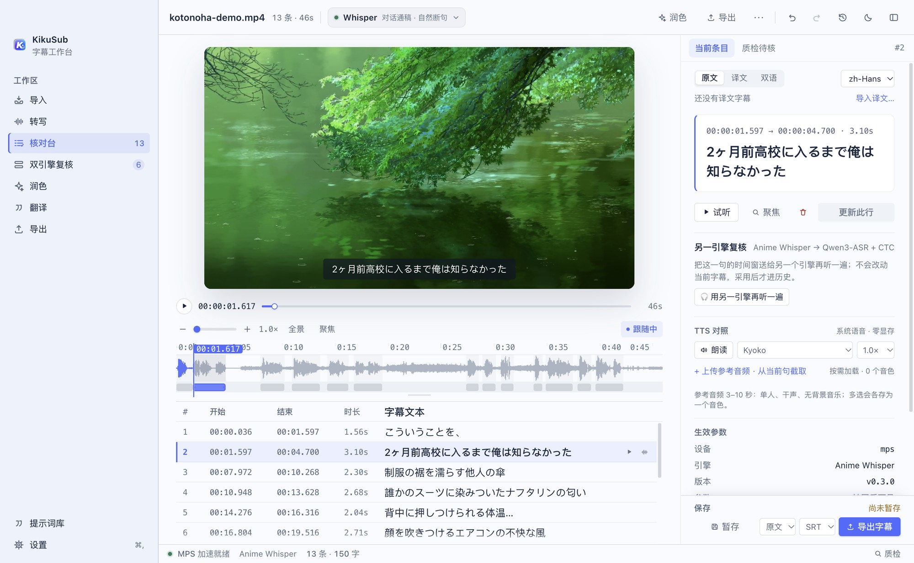
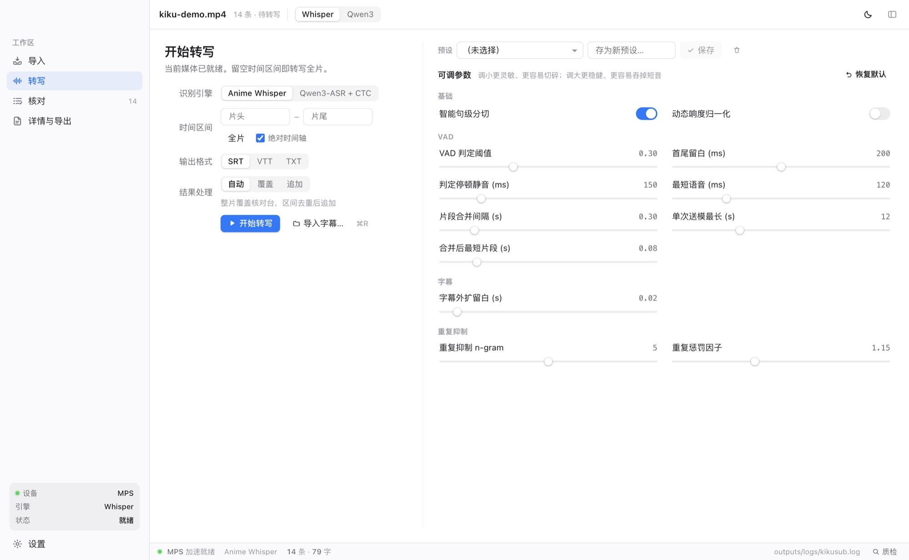
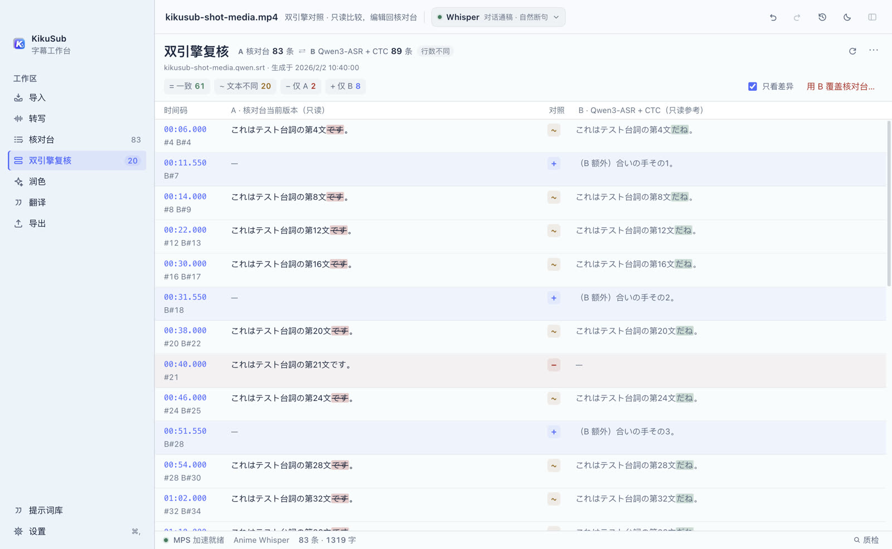
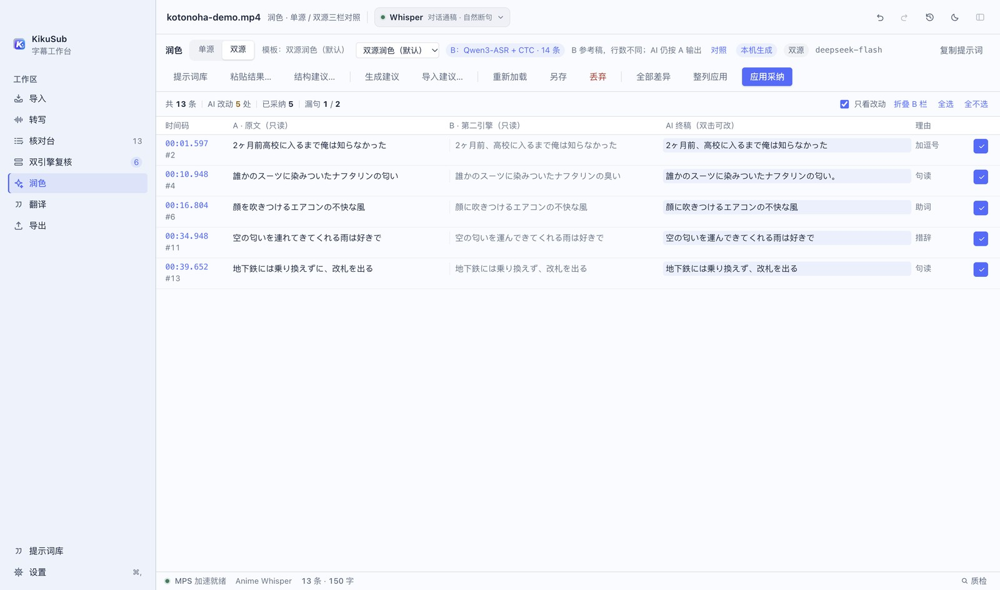
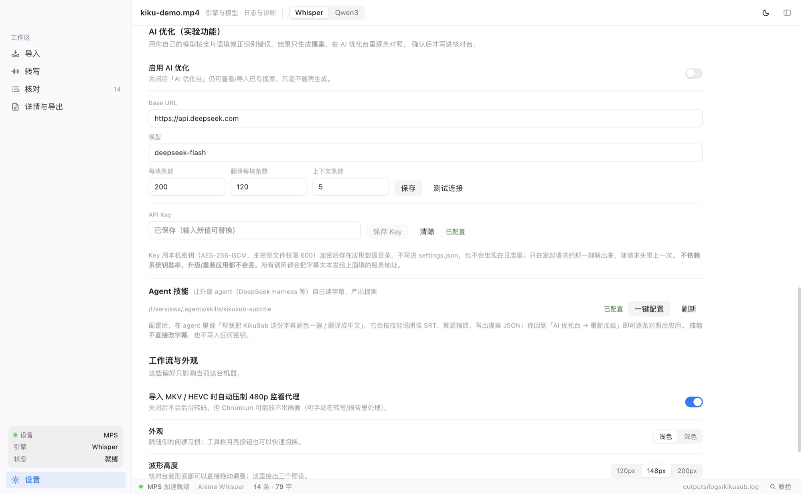

<p align="center">
  
</p>

<h1 align="center">KikuSub</h1>

<p align="center">听清每一句，对准每一帧。</p>

<p align="center">
  macOS 上的本地日语影视字幕工作台：Electron + Svelte 原生外壳，Python 内核负责识别与时间轴。导入 → 转写 → 核对 → 双引擎复核 → 润色 → 翻译 → 导出，一条流水线跑完。
</p>

<p>
  <a href="LICENSE"></a>
  <a href="https://github.com/Alansws/KikuSub/actions/workflows/ci.yml"></a>
  
  
  
  <a href="README_EN.md"></a>
</p>



> 截图里的片源与字幕是演示数据，界面来自当前版本。

---

## 它是什么

一个**只在你自己电脑上跑**的日语字幕工具。视频不出本机、模型权重本地加载，适合处理番剧、电影、日剧、Galgame 录屏和广播剧。

- **转写**：Silero VAD 切分语音，交给可切换的日语识别引擎，输出带时间轴的字幕。
- **核对**：视频与波形同屏，边看边改；拖字幕块就能改时间，双击改字，⌘Z 撤回。
- **质检**：把「可能漏句」「误删待核」「短句可疑」合成一条待核队列，逐条试听、补录。
- **双引擎复核 / 润色 / 翻译**：另一引擎的整片稿进第二列做只读 diff 对照；双源润色同时参考 A/B，仍严格以 A 的时间轴为骨架；翻译进独立平行轨，可导出原文 / 译文 / 双语。
- **提示词库**：提示词模板卡片化，单击选中、双击编辑；复制时自动填入当前字幕的 SRT。
- **导出**：SRT / VTT / TXT，或一键导出带字幕的成片——可选分辨率、「小 / 甜点 / 高 / 极高」码率、烧录硬字幕 / 软字幕 / 仅封装。

除「润色 / 翻译」的自动生成需要你自备模型 API 外，转写、核对与双引擎对照全程本机推理。

## 功能

**导入与转写**

- 拖入视频 / 音频 / 字幕即可导入；MKV、HEVC 这类 Chromium 放不出的格式，导入后在后台自动压一份 480p 监看代理
- 四个可切换的引擎（2 个日语 + 2 个可选中文，见下表），顶部胶囊随时切换；点开列表能看到每个引擎的用途、就绪状态与体积，后续增加引擎也不会挤占工具栏
- 整片转写，或只转一个时间区间（`00:05:00` 或 `300`），可选是否保留原片绝对时间轴
- VAD 阈值、静音判定、最短语音、合并间隔、单段最长时长等参数全部可在界面调；内置 6 套预设，可另存 / 覆盖 / 删除
- FFmpeg `dynaudnorm` 动态响度归一化默认开启（安静母带上不开会把大段台词识别成空段）；不想要可在参数面板关掉
- VAD 按 30s 分窗检测：Silero 整段长跑会因隐状态漂移漏掉清晰台词，分窗后退化消失
- 句首尾的喘气 / 笑声（「んふふ」「えへへ」）默认自动剔除，句中不动；参数面板里「剔除句首尾喘气/笑声」可关掉（动画里角色的笑声算内容时）
- 删掉句首笑声时会同步把字幕起点挪到真正开口处（不会出现「先空一条」）
- 单个假名（「え？」「ん…」）不会被当成碎片丢掉；只有整条全是促音/长音符/符号、或一个假名却拖了 2 秒以上（那是把呼吸判成了语音）才会被丢弃
- 转写中途可打断，已完成部分落盘为 `*.part_cancelled.srt`
- **原文轨与译文轨分别导入**：转写页的「已有字幕」可单独补原文字幕或与当前原文逐条对齐的译文字幕；核对台的「⋯」里也能分别删除原文轨 / 译文轨，重开应用后不必为了补译文重跑转写
- 幻觉门控：识别出但复核为空的整段会被丢弃，可疑短句标出，逐段明细写进任务报告

**核对台**



- 视频、波形、字幕表、检查器四块联动；播放头进入某句，表格自动滚到该句并选中
- 波形按可视窗口取包络，滚轮 / 捏合缩放，双指横移或 ⌥ 拖动平移，最大可放大到零点几秒
- 刻度条、播放头两侧、视频进度条都能按住拖动逐帧擦洗：拖动时暂停、连续 seek，松手恢复播放
- 单击跳转、拖过 4px 才框选；框选后可试听、只转写这一段、或单句重转
- 底部字幕轨道：同区间的双语 / 三语行聚成一块，拖块体整体平移、拖两端单独改起止，一次 ⌘Z 整块回退
- 原文 / 译文 / 双语三态显示；双语是原文在上、译文在下
- 右侧检查器常驻「暂存进度 / 导出」：暂存写工作草稿（0.9s 防抖自动写），导出才是交付文件
- 导入另一版字幕（或恢复暂存草稿）时，右侧会切到当前字幕的来源与条数，旧的质检速览 / 生效参数不再显示；质检队列同时暂停，避免拿上一次转写的条目删错句
- 顶部撤销 / 重做旁有 **50 步统一历史**：字幕、译文、质检状态、导出设置与 AI 建议修改共用一条时间线，每一步写明做了什么，点任意一步直接跳回；⌘Z 永远退回最近一次操作
- 右侧「当前条目」自带 **TTS 对照**：默认用 macOS 本机日语语音（零显存、秒出），也可以在设置里把默认偏好切到克隆音色。面板里可「上传参考音频」（默认打开上次目录 / 当前视频目录，可一次选多段）、「从当前句截取」或右键任意一句「以此句音频新建音色…」，直接用本地 **OmniVoice 零样本克隆**按角色声线朗读。保存过的音色都在「音色库」里，可试听、设为默认、重命名、改参考文本与删除；模型按需下载、空闲 5 分钟自动卸载
- **⌘F 查找与替换**：按当前显示模式查找原文 / 译文 / 双语两行，逐处跳转、替换当前或一键替换全部（原文整批只算一步历史；有「跳过」标记时只替换未跳过的，按钮会变成「替换剩余」）；替换后当前高亮与列表滚动会跟到下一处，「跳过」把这一处标记为本轮不再处理（不写字幕、不进历史、保持原样），上一处 / 下一处快捷键可在 ⌘K 里自定义（默认 ⌘G / ⇧⌘G）。
- **质检面板不再挡画面**：默认收进右侧检查器的「质检待核」页签；需要同时看原文时点「弹出为浮窗」，浮窗可拖到任意位置、拖动右下角改大小、一键归位或停靠回检查器
- 音轨空白处**右键 → 添加字幕**：在光标处居中插入 0.8 秒空字幕并把光标放进右侧文本框，用来手补气声 / 模型识别为空的「啊」之类
- 有字幕处**右键 → 切割字幕**：在光标位置切成两句，两段都先保留完整原文，再分别删掉多余内容；框选两句以上可右键**合并**（双语时译文一起合并）
- 底部字幕轨道支持 **⌘ 单击多选**，一次删除多块；默认 **Enter** 删除当前字幕，可在 **⌘K** 面板里改成任意键。视图键固定为 **⌘1 导入 / ⌘2 转写 / ⌘3 核对台 / ⌘4 双引擎复核 / ⌘5 润色 / ⌘6 翻译 / ⌘7 导出**。设置页可从侧栏「设置（⌘,）」进入
- 所有「聚焦」按钮统一固定 **69×**，不会因为当前已经放大到 145× 再点一次就叠成 415×；「转写选区」完成后自动选中新句，且不改变当前聚焦倍率

**质检待核队列**

- 转写完成后出现在右下角（默认停靠在右侧检查器左边，不挡字幕框与朗读按钮；可拖标题栏移动、双击复位），按时间排序：`missed`（有声音没识别）、`dropped`（识别出但被复核删除）、`suspect`（保留但短或密度低）、`coverage`（主 VAD 没切到的空白间隙）
- 每条都能一键定位、自动框选、补录；处理进度写 `*.qa.json`
- 入口与「有没有待核项」解耦：0 处待核也会显示「✅ 质检完成」，不会整个消失
- 引擎能力如实声明：Qwen3 只覆盖「可能漏句」，另两类明确标注「本引擎不启用」

**双引擎复核、润色与翻译**



- 另一引擎的整片稿进第二列，**不覆盖核对台**；两列只读、实时逐条对齐，像 git diff 一样标出 `=` / `~` / `+` / `−`，`~` 行逐字高亮。**两版行数可以不同**，多出的句子会以独立 `+` / `−` 行显示，不会为了对齐而隐藏
- 第二版按当前媒体自动保存，切走再切回还在；不需要时一键丢弃，或二次确认后整列用 B 覆盖核对台（一次 ⌘Z 全退）
- 侧栏徽标只统计文本差异行；`+` / `−` 漏句在页内单独展示



- 所有 AI 结果先落成一份**建议文件**，软件只负责渲染 diff 与应用——软件内生成、外部 agent 生成，界面完全一样
- **建议里没有时间戳**：时间轴由软件按条号 join 回去，「时间轴不变」是结构保证，不是提示词承诺
- 有第二版时可选**单源 / 双源**：双源三栏 A | B | AI 终稿，B 可折叠；**B 的条数不要求与 A 相同**（两个引擎断句本来就可能不同），AI 终稿仍严格按 A 的序号与时间轴输出。逐条采纳 / 应用全部差异句 / 整列应用都走同一套 `apply_polish()`，一次历史
- 长片外部通道超过阈值会自动切成「智能分段」：在 A/B 静音间隙最大处断开，逐段复制 / 回填并跟踪状态
- 应用 = 整批一次历史，⌘Z 一次全退回；digest / digest_b 不符（换过片、改过原文或第二版）直接拒绝，一个字节都不动字幕
- 翻译进独立平行轨，与原文逐条对齐；条数 / 序号 / 指纹任一不符就整批拒绝
- 导出支持原文 / 译文 / 双语三种，`*.lang.srt` 与 `*.bilingual.srt` 分开命名；双语文件按同一时间轴下原文、译文各一条写（官方双语 SRT 的写法），重新导入核对台不会挤成一行
- 「复制提示词 / 粘贴结果」翻译用提示词库模板；**润色也支持**同一条手动通道，不想用 API 时粘到任意网页版模型，再把回复粘回来——只按顺序取文本，时间轴仍用你自己的
- **结构建议（Phase 1）**：外部模型只需返回 `{"ops":[...]}`（合并 / 改时间 / 改文字 / 新增 / 删除），软件在粘贴时自动绑定源指纹并预览；逐项勾选后一次应用，⌘Z 整批退回。模型不需要输出 digest / version，也不改润色提案的时间轴契约
- **成片导出**：硬字幕走 Pillow 精灵 + ffmpeg overlay，不依赖 libass；软字幕 MP4 可开关字幕；「仅封装」不重编码，几秒完成
- **字幕样式**：烧录硬字幕可选「组标标准 / 粗黑重边 / 番剧圆体 / 电影宋体 / 日式放送 / 清爽细体」等预设，也能单独调字体、字重、字号、描边、阴影与位置；右侧预览直接用当前视频帧渲染，支持「整帧 / 字体特写」两种视角
- **导出设置也能撤销**：字号 / 描边 / 预设 / 形式 / 字幕轨 / 分辨率 / 码率与「再导一份」都进同一条历史；不再按「谁更近」猜域，历史面板就是一组条目，点任意一步跳回
- 自带 Agent 技能（`~/.agents/skills/kikusub-subtitle`），在 DeepSeek Harness 里说一句「帮我把这份字幕翻译成中文」即可

**设置与运行**



- 引擎卡片按注册表渲染：语种、用途、体积、安装状态、启用开关、一键下载；Anime Whisper / Qwen3 / OmniVoice 的「校验 / 补齐」共用同一条进度轨道，校验走不确定进度、下载走真实百分比，完成时短暂变绿再收起
- 运行环境把导出文件夹、成片目录、模型目录、代理缓存、日志目录等**所有路径**汇总在一处；改模型目录会自动重启内核并重新握手
- 日志与诊断：`kikusub.log` / `main.log`，14 天 / 64 MB 保留策略；可「清理旧日志」或「清空全部日志」，「复制最近日志 / 精简诊断」限制体积，不会卡死备忘录
- 外观两套主题：青空（浅色 / 深色）、明朝墨（纸白 + 墨黑 + 一点朱红，字幕用明朝）；在设置页切换，波形高度直接拖动核对台底部调整

## 可切换的引擎

默认启用两个日语引擎：

| | Anime Whisper | Qwen3-ASR + CTC |
| --- | --- | --- |
| 权重来源 | [`litagin/anime-whisper`](https://huggingface.co/litagin/anime-whisper) | [`jaykwok/Qwen3-ASR-1.7B-JA-Anime-Galgame-hf`](https://huggingface.co/jaykwok/Qwen3-ASR-1.7B-JA-Anime-Galgame-hf) |
| 体积 | 约 2.8 GB | 约 3.8 GB |
| 句内时间轴 | 由 VAD 段边界确定，段内按字符数比例分配 | 逐字 CTC 强制对齐，40 ms 帧粒度 |
| 断句依据 | 标点正则 + 字数 / 时长上限 | 标点、停顿、助词、不可切分规则 + 动态规划 |
| 速度 | 较快 | 较慢，每段额外做一次 CTC 前向 |
| 适合 | 先出通稿、长对话、口语流 | 精修、对时间轴敏感的场景 |

两点需要说清楚：

1. CTC 对齐的时间分辨率由声学帧决定。本项目编码器帧为 80 ms、再经 2 倍上采样，因此逐字时间戳的实际粒度是 **40 ms**，不是毫秒级；字幕里的三位毫秒只是格式化结果。
2. Anime Whisper 的句内时间是**近似值**：句边界来自 VAD，段内多条字幕按字符数比例切分。需要精确到字的起止帧时请用 Qwen3 引擎。

另有**两个可选装的中文引擎**：默认停用、权重不随包分发，在设置页「引擎与模型」或首启向导里点一下即可下载
（约 230 MB / 1.2 GB），下载完勾选启用就会出现在顶部切换栏与转写页。

| | SenseVoice-Small 中文 | FireRedASR2-AED 中文 |
| --- | --- | --- |
| 权重来源 | [`csukuangfj/sherpa-onnx-sense-voice-…`](https://huggingface.co/csukuangfj/sherpa-onnx-sense-voice-zh-en-ja-ko-yue-2024-07-17) | [`csukuangfj2/sherpa-onnx-fire-red-asr2-…`](https://huggingface.co/csukuangfj2/sherpa-onnx-fire-red-asr2-zh_en-int8-2026-02-26) |
| 体积 | 约 230 MB（int8） | 约 1.35 GB（ASR 1.2 GB + FireRedPunc 160 MB） |
| 语种 | 中 / 英 / 日 / 韩 / 粤 | 中 / 英 + 20 多种方言 |
| 句内时间轴 | 模型自带 token 时间戳 | **模型不输出时间戳**，句内按字数比例分配 |
| 标点 | ITN 直接输出（可选关） | **FireRedPunc 补标点**（默认开，可关） |
| 断句依据 | 句末标点 → 停顿 → 字数 / 时长 | 标点 → 停顿 → 字数 / 时长 |
| 速度 | 5–6 秒音频约 0.1 秒 | 5–6 秒音频约 1.5 秒（精度更高） |
| 适合 | 中文通稿、中文＋日语混合素材 | 中文精修、方言素材 |

两个引擎都走 [sherpa-onnx](https://github.com/k2-fsa/sherpa-onnx)（ONNX Runtime / CPU），不依赖 FunASR 的
PyTorch 实现，也不需要额外装 kaldi——可选装件不该把主包撑大或拖慢启动。速度是本机 M 系列 CPU、2 线程实测。

**为什么 FireRed 要带标点模型**：中文没有空格，也没有日语助词那种断句线索；一段「一口气说
二三十个字」的识别结果如果完全没有标点，只能按字数硬切，字都对、字幕却难看。FireRedASR2S
的满血组合就是 VAD + AED + FireRedPunc，这里把最后一块也接上了：标点随 FireRed 一起下载
（`<模型目录>/punc/`，约 160 MB），在切字幕之前补回逗号/句号；分句时若标点只比字数上限晚
几个字，会把这一条稍微放长（soft max），避免「特别好」被切成「特 / 别好」。Whisper 与 Qwen 的
日语输出本来就带标点，断句分别依赖标点正则与日语助词动态规划，不需要这一步。

## 安装

### 系统要求

- macOS 12 或更高，Apple Silicon（arm64）
- `ffmpeg` 与 `ffprobe`（`brew install ffmpeg`；应用会把 Homebrew 的路径补进 PATH）
- 磁盘：两个日语转写模型合计约 6.6 GB，两个中文可选引擎另需约 1.4 GB；再加代理缓存与字幕输出，
  建议预留 15 GB。
  想用本地克隆音色再留约 3.3 GB（OmniVoice 权重，首次在核对台点「下载克隆模型」才下载）
- 内存：8 GB 起（实测转写峰值：Anime Whisper 约 6.7 GB、Qwen3-ASR 约 5.1 GB；
  想把系统也留得宽裕就上 12 GB）。注意「权重多大」不等于「吃多少内存」——Anime Whisper
  的 fp32 权重会一路常驻进程，Qwen 直接按 bf16 加载，所以 3.8 GB 的 Qwen 反而比 2.8 GB 的
  Whisper 更省。OmniVoice 克隆按需加载、空闲自动卸载，与转写不会同时常驻

### 使用打包好的 .app

预编译包发布在 [Releases](https://github.com/Alansws/KikuSub/releases)。下载 `KikuSub.app`
后拖进「应用程序」即可；如果那里还没有可用版本，按下面的「打包成 .app」自己构建一个，
产物同样是 ad-hoc 自签名的。

应用是 ad-hoc 自签名的，首次打开若被 Gatekeeper 拦下，在「系统设置 → 隐私与安全性」里点「仍要打开」，或：

```bash
xattr -dr com.apple.quarantine /Applications/KikuSub.app
```

**首次启动**分两步：先选模型目录（默认 `~/Library/Application Support/KikuSub/models`），
再在「配置本地模型」里勾选要下载的引擎——Anime Whisper（推荐）、Qwen3-ASR、可选的两个
中文引擎（SenseVoice-Small / FireRedASR2-AED），以及可选的 **OmniVoice 音色克隆**。点「一键配置所选」会按顺序下载，也可以「稍后再说」，到
「设置 → 引擎与模型」里再配置。模型不会随包分发；下载源默认走 `hf-mirror.com`，支持断点续传。

默认音色仍是 macOS 系统语音（Kyoko 等）；在设置「TTS 对照」里可以切成克隆音色，OmniVoice 只在你主动选择克隆音色时才会加载。

## 从源码运行

### 依赖

```bash
python3 -m venv .venv
source .venv/bin/activate
pip install -r requirements.txt        # torch / transformers / silero-vad / fastapi …
cd desktop && npm install && cd ..     # Electron + Svelte 构建链
```

### 开发模式

```bash
cd desktop
npm run build          # 构建渲染层
npx electron .         # 启动（自动拉起 Python sidecar）
```

sidecar 也可以单独跑，方便调接口：

```bash
source .venv/bin/activate
python -m server --port 0        # 首行输出 {"event":"ready","port":…,"token":…}
```

> 如果 shell 里存在 `ELECTRON_RUN_AS_NODE=1`（某些 Electron 宿主会设），启动前清掉：
> `env -u ELECTRON_RUN_AS_NODE -u NODE_OPTIONS npx electron .`

### 打包成 .app

```bash
bash tools/pack/build_sidecar.sh   # PyInstaller onedir，约 3–5 分钟
bash tools/pack/build_app.sh       # 装配 + 自签，产出 build/pack/KikuSub.app
```

改了 `core/` 或 `server/` 的 Python 代码后必须重跑 `build_sidecar.sh`，否则 `.app` 里还是旧接口——`build_app.sh` 会检查 sidecar 是否比源码旧并拒绝装配。

### 测试

```bash
source .venv/bin/activate
pytest -q                    # Python：内核、服务层、AI 提案与译文轨
ruff check .                 # 风格

cd desktop && npm run test:main   # 主进程：退出清理、密钥存储、技能安装
```

## 工作流程

```text
媒体文件
   │
   ├─ ffmpeg 提取 16 kHz 单声道（可选 dynaudnorm）
   │
   ├─ Silero VAD → 语音段 → 按停顿 / 最长时长合并切分
   │
   ├─ 引擎 A：Anime Whisper              ─→ 文本 → 标点 / 字数分句 → 按比例分配时间
   ├─ 引擎 B：Qwen3-ASR + CTC Head       ─→ 文本 → 强制对齐 → 逐字起止帧 → 动态规划断句
   ├─ 引擎 C：SenseVoice-Small（中文）   ─→ token 时间戳 → 标点 / 停顿 / 字数分句
   └─ 引擎 D：FireRedASR2-AED（中文）    ─→ 文本 → 停顿 / 字数 / 时长分句
   │
   ├─ 字幕自动写入「导出文件夹」，同时进核对台
   │
   ├─ 核对：视频 + 波形 → 校对 / 补录 / 拖动时间 → 暂存或导出
   │
   ├─ 质检：待核队列 → 逐条试听 / 补录 / 保留 / 删除
   │
   └─ AI（可选）：提案 → 双栏对照 → 应用润色或译文 → 导出原文 / 译文 / 双语
```

## AI 优化与翻译怎么配

设置页「AI 优化（实验功能）」里填三样：**Base URL**、**模型名**、**API Key**。任何 OpenAI 兼容的 `chat/completions` 服务都能用，默认值是 DeepSeek。

- **Key 不写进 `settings.json`，也不进日志**：主进程用本机主密钥做 AES-256-GCM 加密，密文放在 `preferences.json`（`aik1:` 前缀），主密钥是 `{dataDir}/.ai-key`（0600）。渲染进程只在发请求的一刻解出明文，随 `X-AI-Key` 头带一次，服务层不读不写不记。
- 不用 `safeStorage` 是刻意选择：本项目以 DMG + ad-hoc 签名分发，每次发版 cdhash 都变，钥匙串条目的 ACL 会全部失效，用户升级后 Key 全部作废。
- 生成走单槽任务队列，进度复用 `/ws/jobs/{id}`；结构不合规只重问一次，仍失败就整份放弃，绝不产出半份提案。
- 改动率超过 40% 会给出提示，防止模型把原话整体改写。
- 取消只能落在分块之间（HTTP 请求不可中断），这是已知限制。

## 运行期目录

| 用途 | 路径 |
| --- | --- |
| 数据 / 输出 / 代理 | `~/Library/Application Support/KikuSub/` |
| 模型 | 首次启动时选择；默认同上 `models/` |
| 启动偏好 | 同上 `preferences.json`（模型目录 / 主题 / 首次设置完成 / AI Key 密文） |
| 日志 | 同上 `outputs/logs/kikusub.log`、`main.log`；14 天 / 64 MB 保留 |
| 导出文件夹 | 设置页可改；字幕交付文件写这里 |
| 成片目录 | 设置页可改；空值跟随导出文件夹，可单独放到另一块磁盘 |
| 代理缓存 | `outputs/web_proxies/`，480p 监看代理；退出时可选择清理 |

开发模式下输出、日志、代理都落在仓库的 `outputs/`，与 sidecar 单独启动时一致。

## 常见问题

**MKV 导入后画面黑屏 / 拖不动？**
Chromium 解不了部分 MKV、HEVC。应用会在后台压一份 480p 代理，压完自动换源；工具栏会显示「代理 42%」这样的实时进度。也可以在转写页手动触发；如果已经有压好的代理文件，在核对台提示条或「⋯」里点「导入代理…」直接挂上，不会重复压制。播放头在代理没压好时照样能走。

**模型下载很慢或失败？**
默认走 `hf-mirror.com`。想直连 Hugging Face，把 `server` 启动环境里的 `HF_ENDPOINT` 改回官方源即可；也可以先用 `huggingface-cli` 把权重下到模型目录。

**AI 生成报 401 / 一直失败？**
先在设置页点「测试连接」。Key 只存在本机；换过机器或删过 `preferences.json` 需要重填。日志里只记 host / model / 状态码 / 耗时，不会出现 Key。

**应用启动后显示「内核未连接」？**
看 `outputs/logs/kikusub.log` 末尾；常见原因是 Python 环境被删、`ffmpeg` 不在 PATH，或模型目录不可写。

**还想要原来的网页版？**
旧版 Gradio 界面已从主仓库移出，源码归档在 Git 标签 [`v0.9-gradio`](https://github.com/Alansws/KikuSub/releases/tag/v0.9-gradio)；本机另有一份可直接运行的独立副本（含模型与 Python 环境）在 `~/Downloads/kikusub_gardio`。主仓库 `app/macos` 分支只维护桌面端。

## 项目结构

```text
core/       算法内核（无 UI 依赖）：VAD、识别、断句、覆盖率、提案、翻译、设置
server/     FastAPI 服务层：/api/*、/media/*、/ws/jobs/*，Electron 的 sidecar
desktop/    Electron 主进程 + Svelte 5 渲染进程（核对台、双引擎复核、润色 / 翻译、设置）
tests/      pytest 回归（内核 / 服务层 / AI 链路）
tools/      评测台、打包脚本、验收小工具
docs/       开发文档与历史记录
```

架构与实现约束写在 [AGENTS.md](AGENTS.md)，AI 这条线的契约写在 [docs/contracts/ai-proposal.md](docs/contracts/ai-proposal.md)。

## 许可

[MIT](LICENSE)。模型权重遵循各自仓库的许可；请只处理你有权使用的素材。
