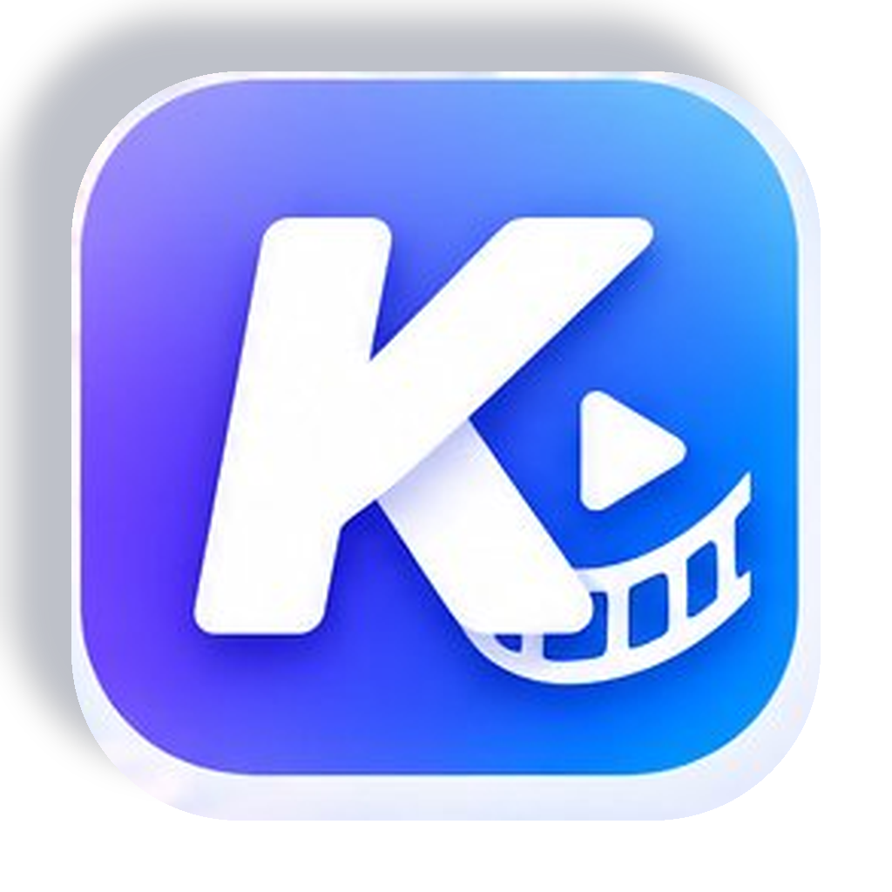
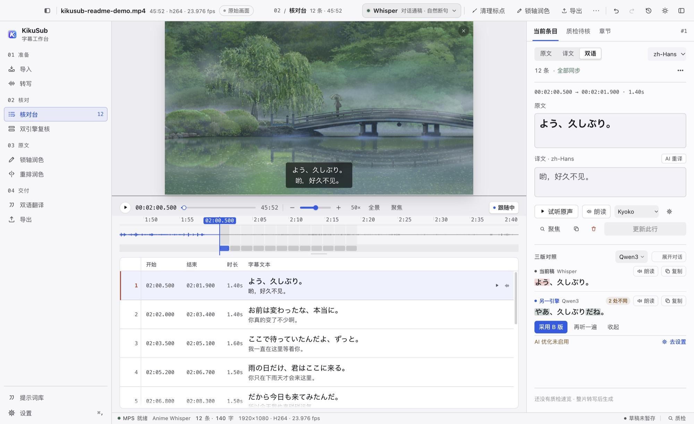
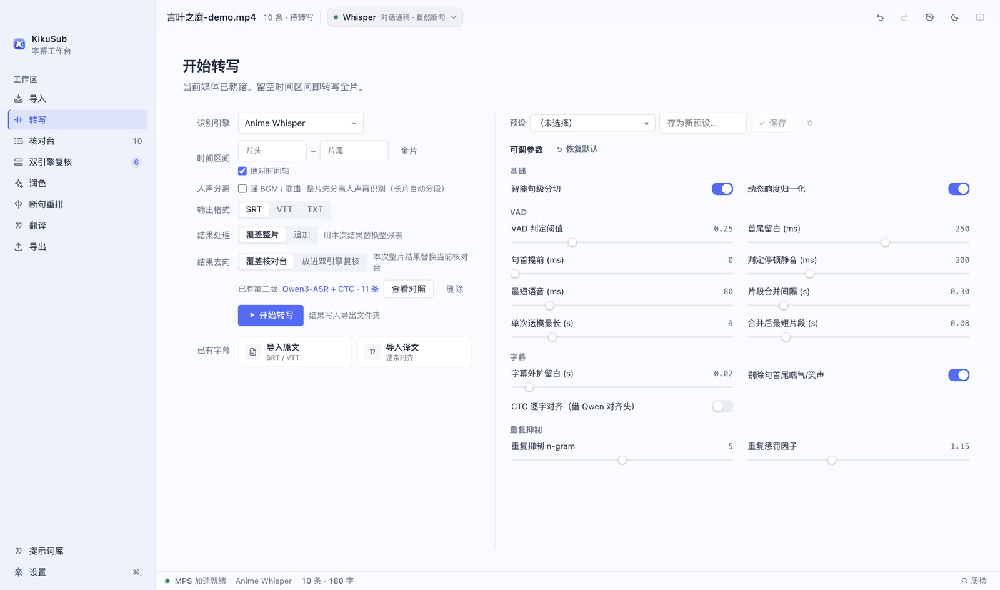
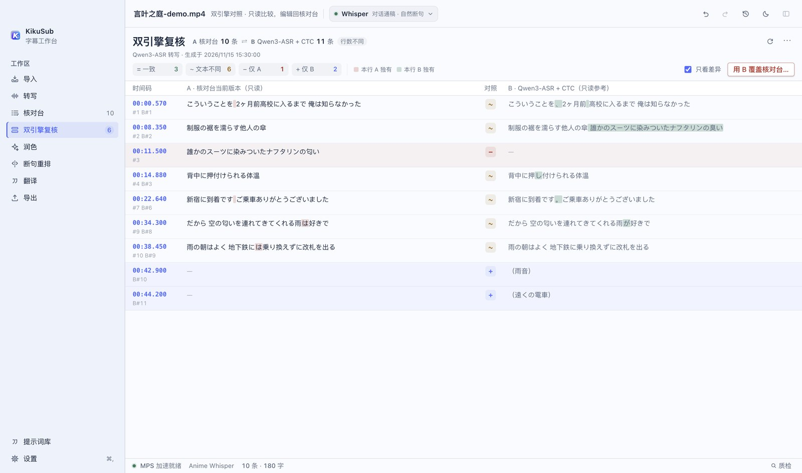
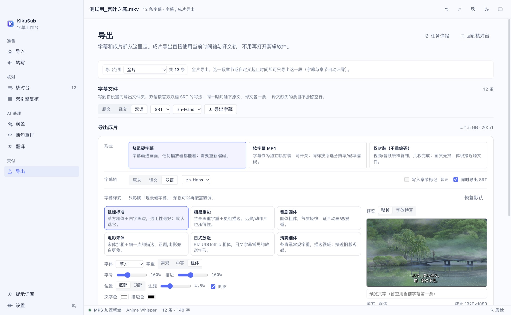
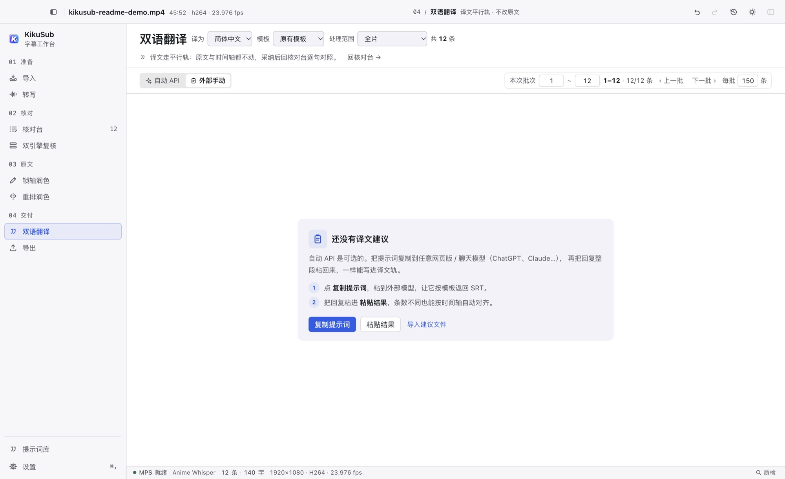
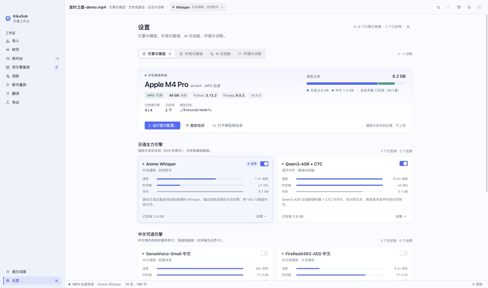
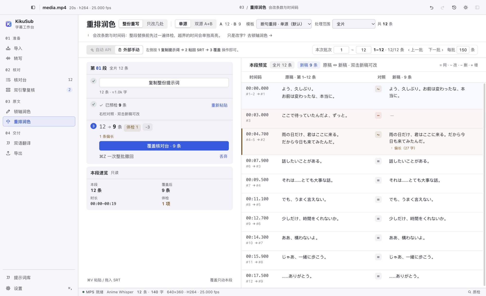

<p align="center">
  
</p>

<h1 align="center">KikuSub</h1>

<p align="center">
  把一部日语生肉变成能交付的字幕，整个过程都在这台 Mac 上。<br>
  <sub>听清每一句，对准每一帧。</sub>
</p>

<p align="center">
  macOS 桌面应用（Electron + Svelte 外壳 · Python 内核）· Apple Silicon 原生 · 全本地推理 · <b>免装 ffmpeg</b> · MIT 开源
</p>

<p align="center">
  <a href="LICENSE"></a>
  <a href="https://github.com/Alansws/KikuSub/actions/workflows/ci.yml"></a>
  
  
  <a href="README_EN.md"></a>
</p>



> 界面截图由应用自身静默渲染（无窗口）；片源与字幕是《言叶之庭》演示数据，日文原文 + 中文译文 + 第二引擎对照。

---

## 三个它不可替代的地方

### 1. 日语影视 / 生肉专用：气声、BGM、快语速之下，时间轴依然咬住开口帧



- **两个日语引擎，各管一种活**：Anime Whisper 重视自然连贯的口语（先出通稿），Qwen3-ASR 带 CTC 对齐头（逐字 40 ms 粒度，时间轴敏感时用）。都只在本机推理。
- **开口气声是硬指标**：VAD 默认 WhisperSeg（对 BGM / 环境音几乎零误检），分窗检测避免长片隐状态漂移；句首静音会被**按音频证据拉回真正开口处**，所以「啊……」这类气声不会变成提前两秒出现、拖得很长的一条。
- **它敢承认自己不确定**：质检队列把「有声音没识别」「识别了但被复核删掉」「短得可疑」「整条只有喘息」分开列出，逐条试听补录——而不是假装整片都识别对了。

### 2. 日语没那么好也能改：空耳 / 罗马音线索 + 前后文，AI 帮你还原漏听台词



- **同一句听两遍**：另一引擎的整片稿进第二列，实时逐行对齐、逐字标出差异（`=` / `~` / `+` / `−`），行内就能 ▶ 试听与「采用 B 句」，一次 ⌘Z 退回。默认忽略标点与空格，虚假差异不会把真正听写分歧埋掉。
- **听不清就让 AI 看一眼**：两版不一致时让 AI 结合前后各 3 句判「第三版」；两版一致时复核；只有一版时纠偏；**两版都空也能救**——补一条空耳 / 罗马音线索（「ん、だーめ」听成了什么）加上下文，它会把台词还原回来。
- **不替你决定**：AI 结果永远只是建议，采用走一次普通字幕编辑（⌘Z 可退），A/B 或时间变了旧结果自动失效；每条判定都能 TTS 念出来核对，追问可以展开成可拖动浮窗，一轮轮收敛。

### 3. 全本地离线、免费开源：双语导出、一键硬字幕成片，不需要剪辑软件



- **双语是真的双语**：按官方双语 SRT 的写法（同一时间轴下原文、译文各一条），重新导入核对台不会挤成一行。
- **成片一条命令的事**：硬字幕走 Pillow 精灵 + ffmpeg overlay，**不依赖 libass**；软字幕 MP4 可开关字幕；「仅封装」不重编码、几秒完成。章节 / 时刻点可以一起写进 MP4 / MKV，IINA 之类播放器能直接跳章。
- **下载即用**：安装包内置 arm64 静态 ffmpeg / ffprobe（FFmpeg 9.1，GPLv3，来源与 sha256 见 [`NOTICE-ffmpeg.txt`](docs/contracts/desktop-lifecycle.md)），**不需要 Homebrew，也不需要 `brew install ffmpeg`**；模型权重不随包，第一次用哪个下哪个。

---

## 三步就把一部片子做完

| ① 导入 | ② 转写 | ③ 核对 / AI | ④ 交付 |
| --- | --- | --- | --- |
| 拖入视频 / 音频 / 字幕。Chromium 放不出的 MKV / HEVC，黑框中央点一下就压 480p 监看代理（不会偷偷在后台压） | 选日语引擎、留空时间区间即整片；专家参数收在页面底部抽屉里，不点开不打扰 | 波形 + 视频 + 表格 + 检查器联动；双引擎复核、AI 润色 / 翻译 / 断句重排 | SRT / VTT / TXT，或直接出带字幕的成片；双语与章节一次带走 |



---

## 和常见做法比一比

自动生成字幕已经是标配。KikuSub 的不同在**后半段**：日语的气声能不能识别、时间轴对不对得上、两版不一致时怎么收敛、最后能不能直接交给对方。

| | **KikuSub** | 通用字幕编辑器（Aegisub / Subtitle Edit 一类） | 云端 AI 字幕服务 |
| --- | --- | --- | --- |
| 日语口语 / 气声 / 笑声 | VAD 分窗 + 句首拉回 + 双日语引擎 | 得自己听打、卡时间 | 通用模型，气声常漏，边界偏粗 |
| 句内时间轴 | Anime Whisper 按 VAD 边界分配；Qwen3 逐字 40 ms | 全手动 | 多为句子级，回来还要重对 |
| 第二意见 | 另一引擎逐行 diff + 行内试听 / 采用 | 没有 | 没有 |
| 校对闭环 | 波形 + 50 步统一历史 + ⌘F 查找替换 + 质检队列 | 有，但要开播放器来回切 | 网页里逐句改，拖不了时间 |
| AI 润色 / 翻译 | 自带；可指本机 LM Studio，也可粘到任意网页模型 | 要自己拼提示词 | 内置，但素材要上传 |
| 交付 | 双语字幕 + 硬字幕成片 + 章节 | 只出字幕 | 只出字幕，成片另找软件 |
| 隐私 / 价格 | 全本地推理，MIT，免费、无账号 | 免费 | 按分钟计费 |



---

## 安装

### 系统要求

- macOS 12 或更高，**Apple Silicon（arm64）**
- **不需要安装 ffmpeg / Homebrew**：安装包自带静态 ffmpeg 与 ffprobe
- 磁盘：两个日语模型合计约 6.6 GB；中文可选引擎另约 1.4 GB；建议留 15 GB
- 内存：8 GB 起（Anime Whisper 峰值约 6.7 GB、Qwen3 约 5.1 GB）；**双引擎顺序协同要求 ≥ 12 GB**，不够时会在开始前明确拒绝，不会跑到一半 OOM

### 使用打包好的 .app

预编译包在 [Releases](https://github.com/Alansws/KikuSub/releases)。下载后拖进「应用程序」即可。
应用是 ad-hoc 自签名、未公证的，首次打开若被 Gatekeeper 拦下，右键「打开」，或：

```bash
xattr -dr com.apple.quarantine /Applications/KikuSub.app
```

**首次启动**分两步：选模型目录（默认 `~/Library/Application Support/KikuSub/models`）→ 勾选日语主力引擎。
默认推荐 Anime Whisper（日常对话）和 Qwen3-ASR（需要逐字时间轴），两个都装也能随时切换；
中文识别引擎与 OmniVoice 音色克隆收在「更多可选扩展」里，按需展开。模型不会随包分发，
下载源默认 `hf-mirror.com`，支持断点续传；想直连 Hugging Face 就把 `HF_ENDPOINT` 改回官方源。

### 从源码运行

```bash
python3 -m venv .venv && source .venv/bin/activate
pip install -r requirements.txt
cd desktop && npm install && cd ..     # Electron + Svelte 构建链
brew install ffmpeg                    # 只有开发模式需要（打包版用内置二进制）

cd desktop && npm run build && npm start   # 会显示窗口；自动化验证一律走 --screenshot（见 AGENTS.md §0.5）
```

sidecar 也能单独跑：`python -m server --port 0`，首行输出 `{"event":"ready","port":…,"token":…}`。

### 打包成 .app

```bash
bash tools/pack/fetch_ffmpeg.sh    # 首次：按钉死的版本 + sha256 取回随包静态 ffmpeg（约 130 MB，不入库）
bash tools/pack/rebuild.sh --no-open   # 按需重打 sidecar → 构建渲染层 → 装配 + 自签，默认不打开
```

改了 `core/` / `server/` 的 Python 代码后必须重打 sidecar —— `build_app.sh` 会检查 sidecar 是否比源码旧并拒绝装配。
验证内置二进制真的能用（在剔掉 Homebrew 的 PATH 下跑打包后的 sidecar）：

```bash
bash tools/pack/verify_bundled_ffmpeg.sh
```

### 测试

```bash
source .venv/bin/activate
pytest -q                              # 内核、服务层、AI 提案与译文轨
ruff check .
cd desktop && npm run test:main        # 主进程：退出清理、密钥存储、技能安装
node tools/shots/verify_reshape_flow.mjs   # 无窗口行为回归（真实界面里跑）
```

---

<details>
<summary><b>转写内核可以调的东西（VAD、双引擎协同、人声分离…）</b></summary>

- **VAD 切分器**：WhisperSeg（默认，BGM / 环境音几乎零误检，首次下载约 114 MB）或 Silero 20s（兼容，免权重）。
  阈值、静音判定、最短语音、合并间隔、单段最长时长都在「专家参数与预设」抽屉里；阈值旁显示当前切分器的标定推荐（WhisperSeg 0.35 / Silero 0.25）并可一键采用。
- **四个引擎各带一套与引擎绑定的标定预设**（日语 ASMR × 2、中文短视频 × 2），下拉只列当前引擎可用的，跨引擎载入会被拒绝。
- **动态响度归一化**（ffmpeg `dynaudnorm`）默认开：安静母带上不开会把大段台词识别成空段。
- **人声分离**（Demucs htdemucs）：整片或任意区间都能先分离；默认只把干净人声用于 VAD、识别仍听原声（不削日语清辅音），人声被纯歌声盖死时可切换成「分离人声送识别」。长片自动分段，峰值内存只跟分段长度走。
- **双引擎顺序协同**：一个任务里先跑主引擎出主稿 → 释放内存 → 用同一份音频跑副引擎；副稿只读进第二列，并把主稿没有的可信句子作为「补漏」送进质检（最多 50 条）。两遍之间过内存闸门，主副引擎可一键交换。
- **结果处理按范围分档**：整片是「覆盖整片 / 追加」，区间多一档「替换选区」（默认，只重写这一段）。转写中途可打断，已完成部分落盘为 `*.part_cancelled.srt`。
- **中文可选引擎**：SenseVoice-Small（约 230 MB，自带 token 时间戳）与 FireRedASR2-AED（约 1.35 GB，FireRedPunc 补标点），都走 sherpa-onnx / CPU，默认停用、按需下载。
- 引擎能力的真实边界写在 [`core/engines.py`](core/engines.py)；断句口径改动必须用 [`tools/eval/score_srt.py`](tools/eval/score_srt.py) 对同一区间跑出 CER / 劈词数作证。

</details>

<details>
<summary><b>核对台：键盘精修、50 步历史与质检队列</b></summary>

- **单击跳转、拖过 4 px 才框选**；点表格行或点底部字幕块（未拖拽）直接把时间选区设为该句起止，`Esc` 只清选区、保留当前行与多选。
- **工作现场按影片记住**：缩放 / 播放头 / 选中行 / 选区按文件路径记最近 50 部，切页、换片再切回、重开应用都回到原处；长片首次打开默认落在第 1 条、约 50× 视野，有译文轨时默认双语。
- **快捷键**：`←` / `→` 逐帧（按真实 fps），`⌘←` / `⌘→` 逐秒，`Q` / `E` 入点 / 出点，`W` 在播放头切割，`⇧Space` 试听当前句，`N` 磁吸，`⇧Z` 全片 / 还原，`1`–`3` 倍速；`⌘1`…`⌘8` 切页，`⌘K` 改键，`⌘F` 查找替换，`⌘⇧L` 清理标点。全部可在设置里改。
- **历史只有一条线**：字幕、译文、质检状态、导出设置与 AI 建议共用 ≤50 步 `WorkspaceState`，每一步都写清楚做了什么，点任意一步跳回，`⌘Z` 永远退最近一次操作。
- **质检待核**：`missed` / `dropped` / `suspect` / `coverage` / `nonverbal` / `ensemble` 六类，逐条定位、试听、补录，进度写 `*.qa.json`；面板默认收在检查器页签里，可弹出成浮窗。
- **TTS 对照**：默认 macOS 本机日语语音（零显存），也能上传参考音频 / 从当前句截取 / 右键任意一句新建 OmniVoice 零样本克隆音色；保存过的音色在「音色库」里可试听、设默认、改名、删除。合成输出统一响度（−18 LUFS / −1.5 dBTP）。
- **章节 / 时刻点**：输入标题回车即插；波形顶部有旗标与色带，点击跳转，增删改都是**一步 ⌘Z**，按影片指纹落盘。

</details>

<details>
<summary><b>AI 处理：一条提案契约、两种执行通道</b></summary>


- **翻译 / 润色 / 断句重排三个页面共用同一条顶部工作条**：第 1 行是模式、模板与处理范围，第 2 行是执行通道 **[ 自动 API | 外部手动 ]**。
- **两种通道产出同一种东西**：一份提案文件。软件内生成、外部 agent 生成，界面完全一样；提案里**没有时间戳**，时间轴由软件按条号 join 回去——「时间轴不变」是结构保证，不是提示词承诺。
- **外部手动是给不配置 API 的人的正路**：复制提示词 → 粘到任意网页模型 → 把回复粘回来，条数不同也能按时间轴对齐（可开「严格要求条数一致」）。没有提案时页面给 1-2 步引导，而不是一片空白。
- **按范围 / 按批次处理**：全片 / 区间章节 / 自定义起止，再叠加条号分批（每批 N 条）；复制、回填、应用都只作用于本批。
- **契约**：源指纹 `digest` / `digest_b` 不符（换片、改原文、改第二版）直接拒绝，一个字节都不动字幕；应用整批只算一步历史。细节见 [`docs/contracts/ai-proposal.md`](docs/contracts/ai-proposal.md)。
- **断句重排**是「整份换稿」车道：条数、切分、时间码、文字都能变；体检只标注不拦路（重叠 / 倒序 / 超长 / 越界），条数腰斩才二次确认。



<details>
<summary>AI 通道细节：本机 LM Studio、单句判定独立配置、上下文档位</summary>


- 全局配置只有三样：Base URL、模型名、API Key（Key 用本机主密钥 AES-256-GCM 加密，落在 `preferences.json`，不进日志、不进 `settings.json`）。
- **单句 AI 判定可以单独指一套**（Base URL / 模型 / Key 分开加密）：把这条通道固定指向本机更宽松的模型（含社区无审查微调），润色 / 翻译继续走全局，互不影响。
- **上下文档位 2048 / 4096 / 8192 只对 loopback 生效**：判定前先轻量探测，模型没加载或档位不符才按选定档位重载一次，已是目标档位就是纯 no-op。
- **自动判定**（「两版不一致时自动 AI 判定」）默认关闭；开启后同一句 + 同一 B 文本只跑一次，切句 / 改文本 / 收起卡片 / 取消都会中断在途请求。
- 自带的 Agent 技能装在 `~/.agents/skills/kikusub-subtitle`，在 DeepSeek Harness 里说一句「帮我润色这份字幕」即可——它只写提案，不改字幕。

</details>

</details>

<details>
<summary><b>导出：字幕样式、片段范围与命名规则</b></summary>

- **三种形式**：烧录硬字幕（重新编码）、软字幕 MP4（可开关字幕轨）、仅封装（不重编码，几秒完成）。
- **六套字幕样式预设**（组标标准 / 粗黑重边 / 番剧圆体 / 电影宋体 / 日式放送 / 清爽细体），也能单独调字体、字重、字号、描边、阴影、位置；右侧预览直接用当前视频帧渲染，支持「整帧 / 字体特写」。
- **片段导出**：全片 / 区间章节 / 自定义起止，时间轴归零重排，章节与时刻点跟着平移，文件名带 `.章节1-00m10s-24m22s` 标签；「仅封装」按关键帧切片（精切请用烧录 / 软字幕重编码）。
- **交付命名**：`言叶之庭.AnimeWhisper.reviewed.srt`、`…reviewed.zh-Hans.srt`、`….bilingual.srt`；同名不同内容自动另存 `(2)`，不同引擎的版本不会互相覆盖。
- 导出设置（形式 / 轨 / 分辨率 / 码率 / 样式）与「再导一份」都在同一条撤销历史里。

</details>

---

## 项目结构

```text
core/       算法内核（无 UI 依赖）：VAD、识别、断句、对齐、提案、翻译、导出
server/     FastAPI 服务层：/api/*、/media/*、/ws/jobs/*，Electron 的 sidecar
desktop/    Electron 主进程 + Svelte 5 渲染层（八视图 + 设置）
tools/      评测台、打包脚本（含随包 ffmpeg）、无窗口截图与回归
docs/       开发文档、领域契约与执行记录
tests/      pytest 回归（内核 / 服务层 / AI 链路）
```

- **工程约束**（内核边界、历史只有一条线、大文件只许变短、不许弹窗…）见 [AGENTS.md](AGENTS.md)；
- **领域契约**按改哪块读哪份，索引在 AGENTS.md §3，细节在 [`docs/contracts/`](docs/contracts/)；
- **发版流程**见 [`docs/release.md`](docs/release.md)（含随包 ffmpeg 的取回与校验）。

## 许可

[MIT](LICENSE)。模型权重遵循各自仓库的许可；请只处理你有权使用的素材。

安装包里随包分发的 ffmpeg / ffprobe 是 **GPLv3** 的静态构建（FFmpeg 9.1，来自
[Martin Riedl 的 Build Server](https://ffmpeg.martin-riedl.de/)）。许可全文、构建配置、
来源与 sha256 都放在包内 `Contents/Resources/bin/`，也可以看
[`docs/contracts/desktop-lifecycle.md` §3.8](docs/contracts/desktop-lifecycle.md)；
上游源码见 [ffmpeg.org](https://ffmpeg.org/download.html)。
