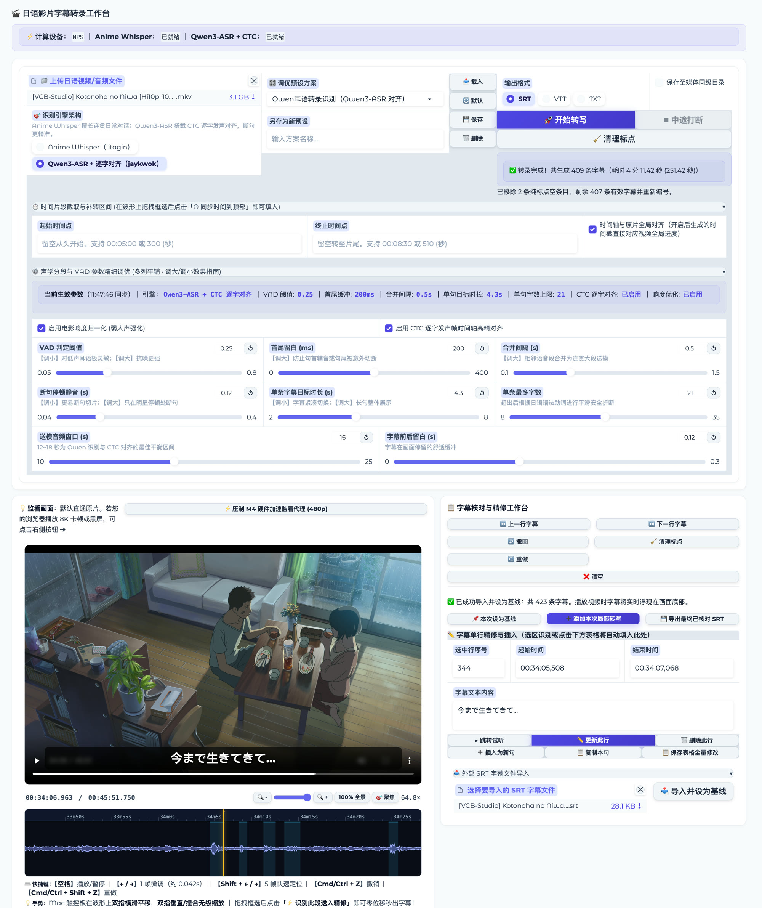
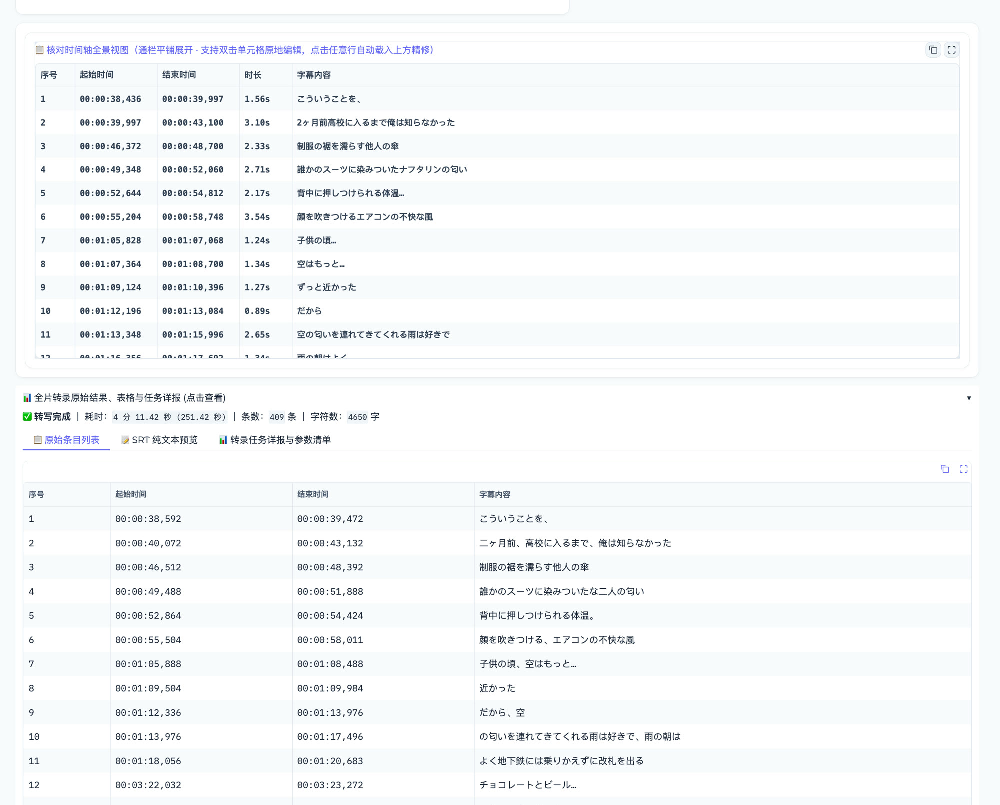

<p align="center">
  
</p>

<h1 align="center">KikuSub</h1>

<p align="center">听清每一句，对准每一帧。</p>

本地运行的日语影视字幕转写与时间轴核对工具，界面基于 Gradio。

上传视频或音频后，程序用 Silero VAD 切分语音段，交给你选择的识别引擎转写，然后在「视频 + 波形」核对台里逐句校对、补录漏句，最后导出 SRT / VTT / TXT。除首次下载模型权重外，全部推理在本机完成，媒体文件不会离开本地。

<p>
  <a href="LICENSE"></a>
  <a href="https://github.com/Alansws/KikuSub/actions/workflows/ci.yml"></a>
  
  
  
  <a href="README_EN.md"></a>
</p>





---

## 功能

**转写**

- 两个可切换的日语识别引擎，见下方对比
- Silero VAD 语音活动检测，按停顿切段；阈值、最短语音、静音判定、合并间隔、单段最长时长均可调
- 可选 FFmpeg `dynaudnorm` 动态响度归一化（单声道下混），用于压低 BGM、抬高低音量人声
- 支持按时间区间转写（`00:05:00` 或 `300`），可选择是否保留原片绝对时间轴
- 转写过程中可随时「中途打断」，已完成部分会写盘为 `*.part_cancelled.srt`
- 清理纯标点 / 纯省略号空行，另存为 `*.clean.srt`

**核对**

- 视频监看与波形时间轴同屏，播放头与视频进度实时同步
- 波形支持滚轮 / 触控板双指平移与缩放，最大 50×（最小可视窗口约 0.4 秒）
- 框选波形区间后可试听、直接识别入轨，或把起止时间同步到顶部转写区
- 单行编辑、删除、插入、整表保存、复制当前句
- 最近 50 步撤销 / 重做，覆盖删除、更新、插入、清空、导入、追加
- 自动草稿与断点：`*.autosave_draft.srt` + `*.progress.json`，重新导入时自动定位到上次校对的行
- 外部 SRT 导入为基线，支持「本次设为基线」与「添加本次局部转写」两种合并方式

**其它**

- 参数预设：内置 6 套，可另存、覆盖、删除
- 任务详报：引擎、耗时、条数、字符数及全部生效参数，可一键复制
- 默认只监听 `127.0.0.1:7860`，单文件上限 10 GB

## 两个引擎

| | Anime Whisper | Qwen3-ASR + CTC |
| --- | --- | --- |
| 权重来源 | [`litagin/anime-whisper`](https://huggingface.co/litagin/anime-whisper) | [`jaykwok/Qwen3-ASR-1.7B-JA-Anime-Galgame-hf`](https://huggingface.co/jaykwok/Qwen3-ASR-1.7B-JA-Anime-Galgame-hf) |
| 句内时间轴 | 由 VAD 段边界确定，段内按字符数比例分配 | 逐字 CTC 强制对齐，40 ms 帧粒度 |
| 断句依据 | 标点正则 + 字数 / 时长上限 | 标点、停顿、助词、不可切分规则 + 动态规划 |
| 重复抑制 | `no_repeat_ngram_size` + `repetition_penalty` | 依赖模型本身，另有字幕级缝合 |
| 速度 | 较快 | 较慢，每段额外做一次 CTC 前向 |
| 适合 | 先出通稿、长对话、口语流 | 精修、对时间轴敏感的场景 |

两点需要说清楚：

1. CTC 对齐的时间分辨率由声学帧决定。本项目编码器帧为 80 ms，再经 2 倍上采样，因此逐字时间戳的实际粒度是 **40 ms**，不是毫秒或微秒级。字幕文件里的三位毫秒只是格式化结果。
2. Anime Whisper 路径的句内时间是**近似值**：句边界来自 VAD，段内多条字幕按字符数比例切分。需要精确到字的起止帧时请用 Qwen3 引擎。

## 工作流程

```text
媒体文件
   │
   ├─ ffmpeg 提取 16 kHz 单声道（可选 dynaudnorm）
   │
   ├─ Silero VAD → 语音段 → 按停顿/最长时长合并切分
   │
   ├─ 引擎 A：Anime Whisper          ─→ 文本 → 标点/字数分句 → 按比例分配时间
   └─ 引擎 B：Qwen3-ASR + CTC Head   ─→ 文本 → 强制对齐 → 逐字起止帧 → 动态规划断句
   │
   ├─ 写出 SRT / VTT / TXT（outputs/ 或媒体同级目录）
   │
   └─ 核对台：视频 + 波形 → 校对 / 补录 / 撤销 → 导出 *.reviewed.srt
```

## 环境要求

- Python 3.10 或 3.11
- `ffmpeg`、`ffprobe` 在系统 PATH 中
- `transformers >= 5.13.0`（Qwen3-ASR 原生支持自该版本起提供，4.x 会直接 ImportError）
- 磁盘：模型权重合计约 7 GB（以 Hugging Face 页面为准），另需字幕输出空间
- 内存：建议 16 GB 以上。Qwen3-ASR 权重约 4 GB，在 CUDA / Apple Silicon 上以 bf16 加载，CPU 上回退 fp32
- 计算设备自动选择：Apple Silicon（MPS）→ NVIDIA（CUDA）→ CPU

## 安装

### 一键脚本

Linux / macOS：

```bash
git clone https://github.com/Alansws/KikuSub.git
cd KikuSub
chmod +x install.sh
./install.sh
source .venv/bin/activate && python app.py
```

Windows（脚本会建好环境并直接启动）：

```cmd
git clone https://github.com/Alansws/KikuSub.git
cd KikuSub
install.bat
```

两个脚本都会先检查 `ffmpeg`，然后创建 `.venv` 并安装 `requirements.txt`。PyTorch 由 `requirements.txt` 按默认源安装；需要指定 CUDA 版本时请用下面的手动步骤。

### 手动安装

```bash
# 1. 虚拟环境
conda create -n kikusub python=3.10 -y
conda activate kikusub

# 2. PyTorch（按平台选择其一）
pip install torch torchaudio --index-url https://download.pytorch.org/whl/cu121   # NVIDIA CUDA 12.1
pip install torch torchaudio                                                     # Apple Silicon / CPU

# 3. 依赖
pip install -r requirements.txt

# 4. 启动
python app.py
```

启动后浏览器访问 <http://127.0.0.1:7860>（脚本会自动打开）。

## 模型权重

模型权重不进仓库（`.gitignore` 已排除 `models/`），首次使用对应引擎时会自动下载到 `models/`。

### 自动下载

程序默认把 `HF_ENDPOINT` 设为 `https://hf-mirror.com`，使用 `snapshot_download` 拉取，支持断点续传。若你希望直连 Hugging Face 官方源，修改 `app.py` 顶部的这一行：

```python
os.environ["HF_ENDPOINT"] = "https://hf-mirror.com"
```

### 手动下载

网络受限或下载中断时，可用 `huggingface-cli` 指定目录：

```bash
pip install -U huggingface_hub

# Anime Whisper
huggingface-cli download litagin/anime-whisper \
  --local-dir models/anime-whisper

# Qwen3-ASR + CTC 对齐头
huggingface-cli download jaykwok/Qwen3-ASR-1.7B-JA-Anime-Galgame-hf \
  --local-dir models/qwen3-asr-ja-anime
```

### 目录结构

```text
models/
├── anime-whisper/
│   ├── config.json
│   ├── generation_config.json
│   ├── model.safetensors
│   ├── preprocessor_config.json
│   ├── tokenizer.json
│   └── vocab.json
└── qwen3-asr-ja-anime/
    ├── config.json
    ├── model.safetensors
    ├── tokenizer_config.json
    ├── vocab.json
    └── ctc_aligner_jav_vocalisation_v3.pt   # CTC 逐字对齐头
```

就绪判定：Anime Whisper 检查 `model.safetensors`；Qwen3 检查 `config.json` 与上述对齐头文件。

### 自定义路径

已有权重放在别处时，用环境变量指过去，无需复制：

```bash
export ANIME_WHISPER_MODEL=/data/models/anime-whisper
export QWEN3_ASR_MODEL=/data/models/qwen3-asr-ja-anime
```

## 使用

1. **上传媒体**：支持 `.mp4 .mkv .mov .webm .avi .m4v .ts` 与 `.wav .mp3 .m4a .flac .ogg .aac`。
2. **选择引擎**：日常对话、需要通稿时选 Anime Whisper；需要精确到字的时间轴时选 Qwen3-ASR。
3. **（可选）调参**：展开「声学分段与 VAD 参数精细调优」，或从预设下拉框载入一套。每个滑块下方都标了「调大 / 调小」的实际效果。
4. **（可选）限定区间**：在「时间片段截取」里填起止时间；也可在核对台波形上框选后点「同步时间到顶部」。勾选「时间轴与原片全局对齐」可让时间戳直接对应原片进度。
5. **开始转写**：进度条与状态行实时更新。需要停止时点「中途打断」，已完成部分会保留。
6. **核对与补录**：左侧波形框选漏句 → 「识别并直接入轨」；或在右侧单行编辑区修改后「更新此行」。所有改动都可撤销。
7. **导出**：核对台点「导出最终已核对 SRT」；转写结果也可在上方直接下载或另存到媒体同级目录。

### 快捷键

| 按键 | 作用 |
| --- | --- |
| `空格` | 播放 / 暂停 |
| `←` / `→` | 前后 1 帧（按 24 fps 计，约 42 ms） |
| `Shift + ←` / `→` | 前后 5 帧 |
| `Cmd/Ctrl + Z` | 撤销 |
| `Cmd/Ctrl + Shift + Z`、`Ctrl + Y` | 重做 |

帧步进按固定 24 fps 换算，与源视频实际帧率无关，用作固定步长的微调。

### 波形操作

- 触控板双指横滑：平移；双指垂直或捏合：无级缩放
- 缩放条范围 1×–50×，「100% 全景」回到全片，「聚焦」以播放头为中心放大
- 拖拽框选后出现工具条：试听选区、识别并直接入轨、同步时间到顶部
- 播放器进度条拖动时只实时刷新时间读数与播放头，松手后才真正跳转（`fastSeek`），长视频拖拽不再卡顿

## 参数与预设

预设保存在根目录 `presets.json`（`版本: 1`，按引擎分 `whisper` / `qwen` 两组键）。写入是原子替换，旧版本文件缺少字段时按默认值补齐。

### Anime Whisper 常用参数

| 参数 | 默认 | 说明 |
| --- | --- | --- |
| VAD 判定阈值 | 0.20 | 调小更灵敏，调大抗噪 |
| 留白缓冲 | 200 ms | 段首尾外扩，防吞音 |
| 判定停顿静音 | 150 ms | 调小切得碎，调大切得长 |
| 最短语音 | 120 ms | 过滤爆音、捕获短叹词 |
| 片段合并间隔 | 0.30 s | 相邻段合并的间隔上限 |
| 单次送模最长 | 12 s | 调小更快更少幻觉 |
| 重复抑制 n-gram | 5 | 0 为关闭 |
| 重复惩罚 | 1.15 | 建议 1.10–1.20 |
| 响度归一化 | 关 | 弱人声场景再开 |

### Qwen3-ASR 常用参数

| 参数 | 默认 | 说明 |
| --- | --- | --- |
| VAD 判定阈值 | 0.28 | 同上 |
| 首尾留白 | 150 ms | 防句首辅音、句尾被切 |
| 合并间隔 | 0.5 s | 相邻语音段合并 |
| 断句停顿静音 | 0.12 s | 低于此长度的停顿不作为断句点 |
| 单条字幕目标时长 | 4.3 s | 超过则计入切分代价 |
| 单条最多字数 | 21 | 超出按日语语法平滑折断 |
| 送模音频窗口 | 16 s | 建议 12–18 s |
| CTC 逐字对齐 | 开 | 关闭后回退到按比例分句 |

## 输出文件

| 文件 | 生成时机 |
| --- | --- |
| `{名称}.srt` / `.vtt` / `.txt` | 转写完成 |
| `{名称}.qwen.*` | 使用 Qwen3 引擎时加引擎后缀 |
| `{名称}_{00m05s-00m08s}.*` | 限定时间区间时带区间后缀 |
| `{名称}.part_cancelled.*` | 中途打断，保存已完成部分 |
| `{名称}.clean.*` | 清理纯标点空行后 |
| `{名称}.autosave_draft.srt` | 每次核对编辑后自动写盘 |
| `{名称}.progress.json` | 记录最后校对行、时间与文本 |
| `{名称}.reviewed.srt` | 核对台导出 |
| `outputs/web_proxies/{名称}_{大小}_preview.mp4` | 手动压制的 480p 监看代理 |

默认写入 `outputs/`；勾选「保存至媒体同级目录」时改写到媒体所在目录。

## 项目结构

```text
KikuSub/
├── app.py                    # Gradio 界面、任务编排、核对台逻辑与前端波形脚本
├── transcribe.py             # 数据结构与格式转换、FFmpeg 抽取、VAD 切分、Anime Whisper 流水线
├── qwen_ctc.py               # Qwen3-ASR 推理、CTC 对齐头、日语断句动态规划、字幕缝合
├── presets.py                # presets.json 校验、兼容读取与原子写入
├── presets.json              # 内置参数预设
├── requirements.txt
├── ruff.toml                 # Lint 规则配置
├── install.sh / install.bat  # 安装脚本
├── .github/workflows/ci.yml  # Ruff 检查、语法编译与预设校验
├── README.md / README_EN.md
├── CONTRIBUTING.md
├── LICENSE
├── docs/                     # README 截图与 logo
├── models/                   # 模型权重，不入库
└── outputs/                  # 字幕与代理产物，不入库
```

## 常见问题

**启动报 `ffmpeg: command not found`**
装好 FFmpeg 并确保在 PATH 中：macOS `brew install ffmpeg`，Ubuntu `sudo apt install ffmpeg`，Windows `winget install Gyan.FFmpeg`。

**模型下载卡住或失败**
默认走 `hf-mirror.com`。若该镜像不可用，改 `app.py` 顶部的 `HF_ENDPOINT`，或用上面的 `huggingface-cli` 手动下载后放进 `models/`。

**`ImportError: cannot import name 'AutoModelForMultimodalLM'`**
`transformers` 版本过低。Qwen3-ASR 原生支持从 5.13.0 开始提供，执行 `pip install -U "transformers>=5.13.0"` 后重试。

**识别结果重复复读**
调大「重复抑制 n-gram」或「重复惩罚」，并把「单次送模最长」降到 8–12 s。

**整段漏句 / 弱人声没识别到**
调低 VAD 阈值（0.20 以下）、调大留白缓冲，并开启响度归一化；仍漏的话直接在波形上框选补录。

**视频黑屏或卡顿**
浏览器对 MKV 容器和部分 HEVC 编码支持有限。点「压制 M4 硬件加速监看代理 (480p)」生成代理；macOS 走 VideoToolbox，其它平台回退到 libx264。

**Apple Silicon 上部分算子报错**
代码已设置 `PYTORCH_ENABLE_MPS_FALLBACK=1`，个别算子会回退 CPU，速度略降但可运行。

**显存 / 内存不足**
先用 Anime Whisper 跑通，或降低「送模音频窗口」。两个引擎同时加载会各自占用一份显存。

## 已知限制

- 一次处理一个文件，没有批量队列
- 仅面向日语，不做翻译、不做字幕渲染与压制
- 界面文案为中文，未做 i18n
- 帧步进按 24 fps 换算，不读取源视频真实帧率
- `outputs/` 与 `models/` 不做清理，长期使用需自行管理磁盘
- 模型权重遵循各自仓库的许可证，与本项目 MIT 许可相互独立

## 致谢

本项目的识别能力来自以下开源工作：

- [litagin/anime-whisper](https://huggingface.co/litagin/anime-whisper)：面向日语动漫语料微调的 Whisper 模型
- [jaykwok/Qwen3-ASR-1.7B-JA-Anime-Galgame-hf](https://huggingface.co/jaykwok/Qwen3-ASR-1.7B-JA-Anime-Galgame-hf)：Qwen3-ASR 日语微调权重与 CTC 对齐头
- [silero-vad](https://github.com/snakers4/silero-vad)：语音活动检测
- [Gradio](https://www.gradio.app/)：Web 界面
- [FFmpeg](https://ffmpeg.org/)：音视频抽取与转码

## 贡献

Issue 与 Pull Request 都欢迎。开发环境搭建、代码约定、提 issue 需要附带哪些信息，见 [CONTRIBUTING.md](CONTRIBUTING.md)。

## 许可证

本仓库的代码（`app.py`、`transcribe.py`、`qwen_ctc.py`、`presets.py` 及界面脚本）以 [MIT License](LICENSE) 发布。

运行时下载的模型权重不在此许可范围内，请分别查阅上述 Hugging Face 仓库的许可条款后再用于分发或商用。
