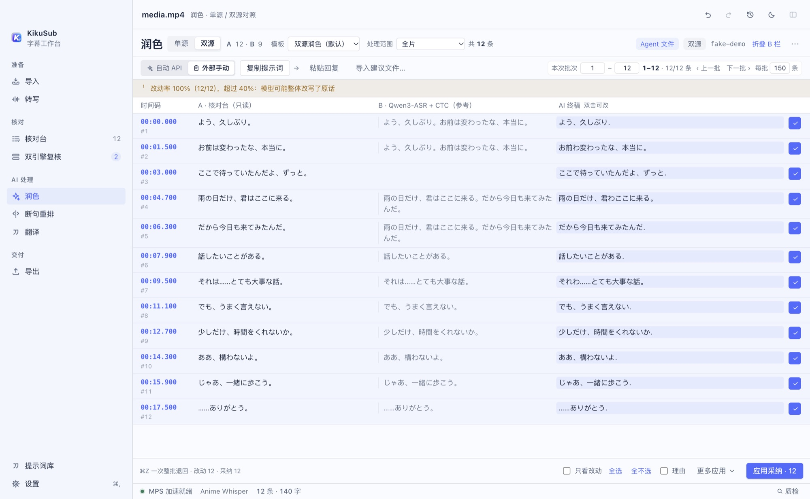
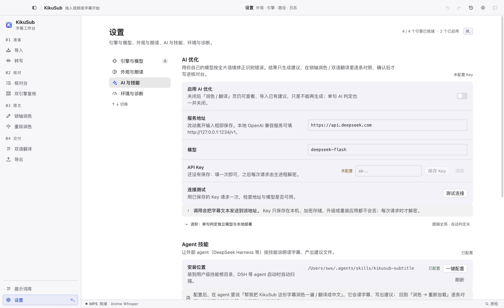

<p align="center">
  
</p>

<h1 align="center">KikuSub</h1>

<p align="center">
  专为日语影视与生肉打造的 Mac 本地字幕工作台。<br>
  <sub>从识别、听音纠偏到双语成片导出，全程在你的 Mac 上完成。</sub>
</p>

<p align="center">
  Apple Silicon 原生加速 · 音画不出本机 · 下载即用 · 免费开源
</p>

<p align="center">
  <a href="LICENSE"></a>
  <a href="https://github.com/Alansws/KikuSub/actions/workflows/ci.yml"></a>
  
  
  <a href="README_EN.md"></a>
</p>


> 图中片源为《言叶之庭》演示片段，展示日语原文、中文译文与逐帧波形核对状态。

---

## KikuSub 解决什么问题

市面上能做语音转文字的工具很多，但拿来处理**日语番剧、日剧、电影或 Galgame 录屏**时，往往会卡在三个地方：气声叹词被吞掉、字幕提前两秒冒出来、以及日语不够好时看着满屏假名根本无从校对。KikuSub 的设计全程围绕这三件事。

### 1. 日语对话专用：有背景音、气声和快语速时，时间轴依然卡准开口那一帧


- **两套主力日语模型各司其职**：Anime Whisper 擅长长对话与口语连贯度，适合先出通稿；Qwen3-ASR 擅长逐字卡准起止帧，适合对时间轴要求极高的精修与压制。两个模型均在本地运行。
- **专治“提前亮字幕”与吞字**：针对日语影视常见的轻声叹词和密集 BGM 做了静音边界校准，把漂移的字幕起点拉回角色真正开口的位置，避免一句喘息拖出两三秒空字幕。
- **没把握的地方会主动标出来**：声音太轻、疑似漏句或只有喘息笑声的片段会自动收进「质检待核」列表，让你逐条点开试听补录，而不是硬编一句糊弄过去。

### 2. 日语没那么好也能改：双引擎互相印证，写句“空耳”让 AI 帮你还原


- **一句话听两遍，只看真正有分歧的地方**：把另一套引擎的识别结果放在第二列对照，默认自动屏蔽逗号、省略号这类无关标点差异，只高亮真正听出不同词汇的行；页内点一下就能试听原声并一键替换，改错了随时 `⌘Z` 撤回。
- **听不清时写个提示就行**：遇到两个引擎都没听准、甚至整句空白的气声词，在右侧输入你听到的空耳或罗马音线索（例如「听起来像 sugoi / 声音很小」），AI 会结合前后各 3 句台词帮你推回最合理的日文表达。
- **改动的决定权永远在你手里**：AI 生成的修正、润色和翻译都先以对照提案呈现，不会擅自覆盖原稿；如果你需要处理敏感台词或纯离线运行，还可以把单句纠偏单独指向本机 LM Studio / Ollama，不经过任何云端服务。

### 3. 从字幕到带章节的双语成片，一个软件直接交差


- **真双语与常用样式开箱即用**：内置「组标标准」「番剧圆体」「日式放送」「电影宋体」等 6 套字体样式，右边直接套在当前视频帧上预览；双语 SRT 严格按“同一时间轴下原文、译文各一条”输出，重新导回也不会挤成一团。
- **不用再开剪辑软件压制**：支持直接烧录硬字幕、封装可开关的软字幕 MP4，或几秒钟无损封装；在核对台打好的章节和时刻点会一并写入视频容器，用 IINA 等播放器可直接按章节跳转。
- **下载即用，不折腾命令行**：打包版内置了所有必需的音视频处理组件，不需要手动安装 Homebrew 或配置环境；首次启动按提示挑一个喜欢的日语模型即可开始。

---

## 一部片子的完整走法

| 1. 导入 | 2. 转写 | 3. 核对与翻译 | 4. 导出 |
| --- | --- | --- | --- |
| 直接拖入视频、音频或已有字幕；浏览器内核放不出的 MKV / HEVC 格式，可在黑框中央一键生成轻量监看代理 | 选「日语自然对话」或「逐字精确时间轴」，按需勾选「强 BGM / 歌曲人声分离」或只转某一段；复杂调参收在底部抽屉，日常不用管 | 在核对台拖拽波形改时间轴，或切到双引擎复核与 AI 处理页完成校对、断句重排与中文翻译 | 导出 SRT / VTT / TXT，或直接按设定分辨率与码率输出带双语字幕和章节的成片 |


---

## 和常见做法比一比

| | **KikuSub** | 传统字幕软件（Aegisub 等） | 在线 AI 字幕网站 |
| --- | --- | --- | --- |
| 日语口语与气声 | 专为日语影视微调的双引擎 + 句首对齐校准 | 全靠人工听打与打轴 | 通用模型，气声和轻声句容易漏 |
| 没听清怎么救 | 第二引擎对照 + 空耳线索结合上下文还原 | 反复慢放盲猜 | 只能网页里自己硬改 |
| 核对体验 | 视频 + 可缩放波形 + 50 步统一撤销 + 质检队列 | 界面偏老，波形与视频配置繁琐 | 多为纯表格，很难逐帧卡时间轴 |
| AI 润色 / 翻译 | 可接云端 API、本机大模型，或免费复制给网页 AI | 需手动导出文本折腾 | 需上传原片/音频到别人服务器 |
| 隐私与费用 | 全本地免费开源，不设账号、不按分钟收费 | 免费 | 按时长计费，素材出本机 |


---

## 下载与使用

### 运行环境

- **电脑**：Apple Silicon（M1 / M2 / M3 / M4 系列）Mac，macOS 12 或更高版本
- **硬盘空间**：建议预留 15 GB（两个主力日语模型合计约 6.6 GB，加上代理缓存与成片输出）
- **内存**：8 GB 起步即可运行单引擎转写（Anime Whisper 峰值约 6.7 GB，Qwen3-ASR 约 5.1 GB）；如需同时开启「双引擎顺序协同」，需要 12 GB 及以上内存（不足时会在开始前明确拒绝，不会跑到一半 OOM）
- **零前置依赖**：正式安装包已内置音视频处理组件，**无需提前安装 Homebrew 或 ffmpeg**

### 安装步骤

1. 前往 [Releases](https://github.com/Alansws/KikuSub/releases) 下载最新安装包，将 `KikuSub.app` 拖入「应用程序」。
2. **首次打开授权**：应用采用 ad-hoc 自签名、尚未公证，第一次打开若被 macOS 拦截，右键应用图标选「打开」，或在终端运行一次：
   ```bash
   xattr -dr com.apple.quarantine /Applications/KikuSub.app
   ```
3. **选择语言模型**：首次启动会引导选择模型存放位置，默认推荐勾选一个日语主力模型即可开用（国内网络默认走镜像加速并支持断点续传；需要直连 Hugging Face 可通过 `HF_ENDPOINT` 环境变量切换）。

---

## 进阶功能与开发者文档

如果你是字幕组重度调参用户、本地大模型玩家，或者想从源码编译参与贡献，可按需展开以下说明。

<details>
<summary><b>转写与听音细节（VAD、人声分离、双引擎协同、中文可选引擎）</b></summary>

- **双切分器可选**：默认采用对背景音乐与环境音误检极低的 WhisperSeg（首次使用按需下载约 114 MB），也可切回 Silero 20s；专家抽屉内提供阈值、静音判定、合并间隔、n-gram 重复抑制等全部微调参数（Anime Whisper 共 18 项），以及随引擎绑定的多套预设。
- **人声分离（Demucs）**：面对纯歌声或喧闹现场音时，可开启人声分离（默认只用分离人声做断句切分、识别仍听原音以保住日语清辅音；歌声彻底盖过人声时可切换为分离音轨直出识别），长片自动分段控制内存峰值。
- **双引擎顺序协同**：在 ≥ 12 GB 内存机型上，可在一次任务内先后跑完主副两个引擎，主稿进核对台、副稿进第二列对照，并将主稿漏掉的可信句子自动送入质检队列（最多 50 条）。
- **区间与续传**：支持只转写指定时间区间并保留原片绝对时间轴（默认「替换选区」，不误删其余字幕）；转写中途取消时已完成片段会落盘为 `*.part_cancelled.srt`。
- **可选中文引擎**：内置支持 SenseVoice-Small（约 230 MB）与 FireRedASR2-AED（约 1.35 GB，含标点恢复），默认停用、在「设置 → 引擎与模型」按需下载启用。
- 引擎指标口径见 [`core/engines.py`](core/engines.py)，断句与对齐评测工具见 [`tools/eval/score_srt.py`](tools/eval/score_srt.py)。

</details>

<details>
<summary><b>核对台效率工具（快捷键、音色克隆朗读、章节标记）</b></summary>

- **流畅视听与精确编辑**：单击跳转、拖动超过 4 px 才建立选区；点表格行或字幕块即可选中对应时间段，`Esc` 只清时间选区不丢当前行；工作缩放与播放头位置按影片自动记住（最近 50 部）。
- **常用快捷键**：`←` / `→` 按真实帧率逐帧移动，`⌘←` / `⌘→` 逐秒移动，`Q` / `E` 对齐入出点，`W` 切割字幕，`⇧Space` 试听当前句，`N` 磁吸对齐，`⌘F` 查找替换，`⌘⇧L` 批量清理标点，`⌘1`…`⌘8` 切换工作视图，`⌘K` 可全部改键。
- **50 步统一撤销线**：字幕增删、时间拖动、AI 采纳、质检状态与导出设置共用同一条历史记录，随时点选任意历史节点直达或 `⌘Z` 回退。
- **语音对照与角色音色克隆**：默认使用 macOS 系统日语语音快速朗读对照；也可截取视频里某角色 3–10 秒原声，通过本地 OmniVoice 模型进行零样本声音克隆朗读（按需下载、空闲 5 分钟自动卸载）。
- **章节与时刻点**：随时在播放头插时刻点或将选区设为章节，波形顶部以色带与旗标呈现，导出时可写入 MP4 / MKV 容器，也支持只导出某一章节片段并自动归零时间轴。

</details>

<details>
<summary><b>AI 处理、数据隐私与本机大模型接管</b></summary>



- **严格的时间轴保护**：无论是内置 API 生成还是外部网页复制回填，AI 提案都不包含时间戳——软件按源指纹（`digest`）与条号回填文本，确保源字幕改动后旧提案自动失效、不会错位覆盖。如果希望重新划分句长与时间轴，可使用专门的「断句重排」车道。
- **双通道随意切换**：不配 API Key 时默认落在「外部手动」，支持自动分批复制提示词并在回填时按时间戳智能对齐（不强求网页模型输出完全一致的条数）。
- **本地密钥安全与判定独立覆盖**：API Key 使用本机主密钥做 AES-256-GCM 加密存储；「设置 → AI 与技能 → 进阶」中可单独为单句判定配置一套本机模型（如 LM Studio / Ollama 的无审查微调模型），并自动校准 `2048 / 4096 / 8192` 上下文档位，与全局润色/翻译配置互不干扰。
- **Agent 技能包**：支持一键安装技能到 `~/.agents/skills/kikusub-subtitle`，在外部 AI 助手中直接基于当前字幕文件生成标准润色或翻译提案（契约见 [`docs/contracts/ai-proposal.md`](docs/contracts/ai-proposal.md)）。



</details>

<details>
<summary><b>从源码运行、打包与回归测试（面向开发者）</b></summary>

**项目结构**

```text
core/       算法内核（无 UI 依赖）：VAD、识别、断句、CTC 对齐、提案校验、导出
server/     FastAPI 服务层（Electron 的本地 sidecar）
desktop/    Electron 主进程 + Svelte 5 渲染层
tools/      评测台、打包脚本（含静态 ffmpeg 获取与校验）、无窗口截图回归工具
docs/       领域契约与发布流程
tests/      pytest 回归测试
```

**开发环境启动**

```bash
python3 -m venv .venv && source .venv/bin/activate
pip install -r requirements.txt
cd desktop && npm install && cd ..
brew install ffmpeg                    # 开发态需本机安装 ffmpeg

cd desktop && npm run build && npm start
```

> 服务层可单独调试：`python -m server --port 0`。工程规范与无窗口自动化验证规则见 [`AGENTS.md`](AGENTS.md)，发版流程见 [`docs/release.md`](docs/release.md)。

**打包为独立 .app 与验证**

```bash
bash tools/pack/fetch_ffmpeg.sh        # 首次打包获取随包静态 ffmpeg / ffprobe（约 130 MB）
bash tools/pack/rebuild.sh --no-open   # 构建 sidecar 与渲染层，装配并自签 .app
bash tools/pack/verify_bundled_ffmpeg.sh
```

**运行测试**

```bash
source .venv/bin/activate
pytest -q && ruff check .
cd desktop && npm run check && npm run check:svelte && npm run test:main
node tools/shots/verify_reshape_flow.mjs
```

</details>

---

## 许可

KikuSub 本体源码基于 [MIT](LICENSE) 协议开源。所涉及的 AI 模型权重遵循各自上游仓库的许可协议，请仅处理你有权使用的音视频素材。

打包分发的 `.app` 内附带来自 [Martin Riedl Build Server](https://ffmpeg.martin-riedl.de/) 的静态构建 `ffmpeg` / `ffprobe`（FFmpeg 9.1，采用 **GPLv3** 协议）；完整许可文本、来源与 sha256 校验信息随包保存在 `Contents/Resources/bin/`（详情参见 [`docs/contracts/desktop-lifecycle.md` §3.8](docs/contracts/desktop-lifecycle.md)），上游源码见 [ffmpeg.org](https://ffmpeg.org/download.html)。
