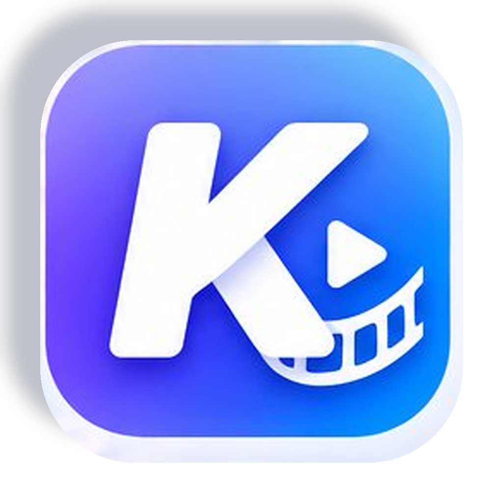
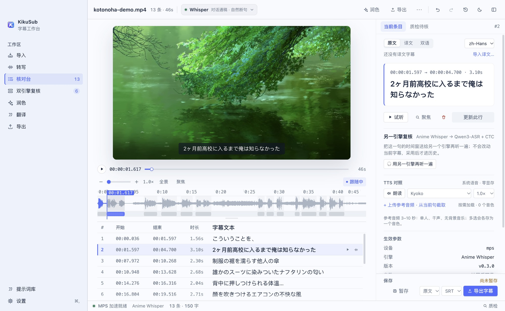
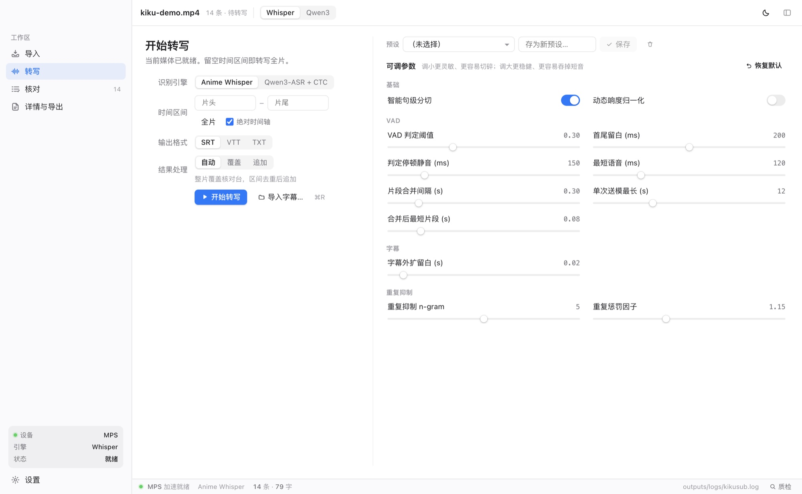
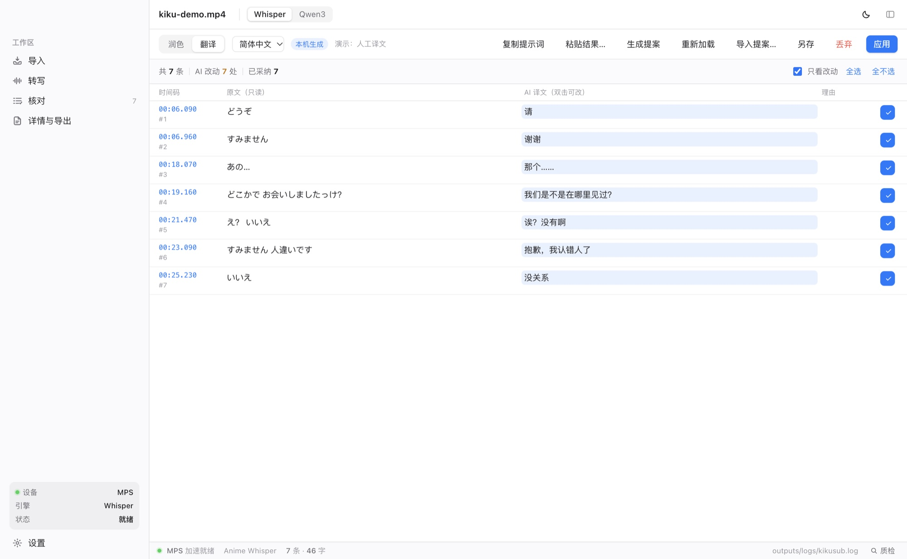
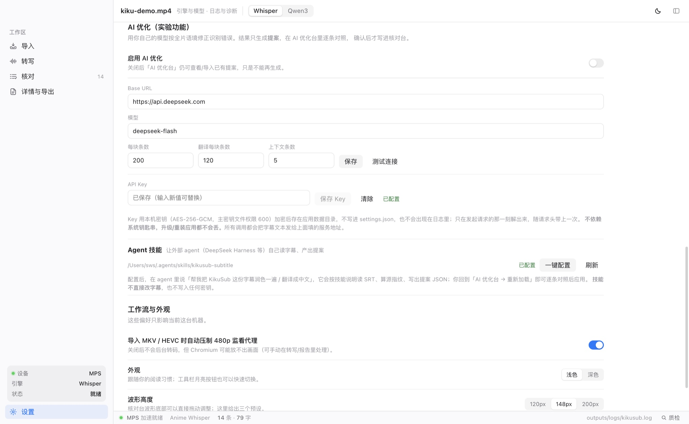

<p align="center">
  
</p>

<h1 align="center">KikuSub</h1>

<p align="center">Hear every line. Hit every frame.</p>

<p align="center">
  A local-first Japanese subtitle workbench for macOS. An Electron + Svelte shell on top of a Python core: import → transcribe → review → QA → AI polish / translate → export, in one pipeline.
</p>

<p>
  <a href="LICENSE"></a>
  <a href="https://github.com/Alansws/KikuSub/actions/workflows/ci.yml"></a>
  
  
  
  <a href="README.md"></a>
</p>



> The source and subtitles in the screenshots are demo data; the UI is from the current build.

---

## What it is

A Japanese subtitle tool that runs **entirely on your own machine**. Your video never leaves the computer, model weights are loaded locally, and the whole thing is built for anime, films, J-dramas, Galgame recordings and radio plays.

- **Transcribe** — Silero VAD segments the speech, then a switchable Japanese engine produces timed subtitles.
- **Review** — video and waveform side by side; drag a cue block to retime it, double-click to edit, ⌘Z to undo.
- **QA** — missed speech, dropped lines and suspicious short cues are merged into one queue you can audition and patch.
- **AI polish / translate** — your own model produces a *proposal*; you diff it in two columns, then apply the batch. Translations live in a parallel track and export as source, target or bilingual.
- **Prompt library** — prompt templates as cards: click to select, double-click to edit; copying fills in the current SRT.
- **Export** — SRT / VTT / TXT, or a one-click video export with burned-in / soft subtitles, resolution and a "small / sweet spot / high / ultra" bitrate ladder.
- **Export settings are undoable too** — font size, outline, presets, mode, track, resolution and quality share one history with subtitles, translations, QA state and AI suggestion edits; ⌘Z always undoes the most recent step, and the history panel is a single list.
- **Subtitle styles** — burned-in subtitles come with fansub-style presets (standard, heavy outline, rounded anime, movie serif, Japanese broadcast, light) plus per-field control over font, weight, size, outline, shadow and position. The preview renders with the real video frame and offers full-frame and font close-up views.

Everything except the optional AI features is local inference.

## Features

**Import & transcribe**

- Drag in video, audio or subtitles. MKV and HEVC — which Chromium cannot decode — get a 480p preview proxy built in the background.
- Two switchable Japanese engines (see below). The top capsule opens a list with each engine's purpose, readiness and size, so adding more engines later will not crowd the toolbar.
- Transcribe the whole file, or a single range (`00:05:00` or `300`), optionally keeping the original absolute timeline.
- All VAD knobs are exposed: threshold, silence, minimum speech, merge gap, maximum segment. Six built-in presets, plus save / overwrite / delete.
- Optional FFmpeg `dynaudnorm` to push down BGM and lift quiet dialogue.
- Cancel mid-run and keep what finished (`*.part_cancelled.srt`).
- **Import source and target tracks separately**: the Transcribe page's “existing subtitles” cards can load a source SRT/VTT or a target SRT/VTT aligned to the current source; the Review desk “⋯” menu can delete either track independently, so a restart no longer forces a full re-transcription just to restore translations.
- Hallucination gate: segments transcribed but re-checked as empty are dropped, suspicious short cues are marked, and the per-segment details go into the task report.

**Review desk**



- Video, waveform, cue table and inspector stay in sync: when the playhead enters a cue, the table scrolls to it and selects it.
- The waveform is fetched per visible window; scroll / pinch to zoom, two-finger pan or ⌥-drag to move. Zoom goes far enough to see a fraction of a second.
- Ruler, playhead edges and the video progress bar are all scrubbable: playback pauses, the frame follows every 16 ms, and the previous state resumes on release.
- Click to seek; drag past 4 px to start a selection. A selection can be auditioned, transcribed on its own, or a single cue can be re-transcribed.
- Cue lane at the bottom: bilingual / trilingual lines sharing a time range form one block. Drag the body to shift both edges, drag an edge to retime one side — a single ⌘Z undoes the whole move.
- Source / target / bilingual display; bilingual shows the source line above the target line.
- The inspector always carries **Save draft / Export**: drafts autosave with a 0.9 s debounce, export writes the deliverable.
- Importing another subtitle (or restoring a draft) switches the inspector to the current source and cue count; stale QA overview and transcription params are hidden, and the QA queue pauses so old items cannot delete cues from the new table.
- **50-step unified history** next to undo / redo: subtitles, translations, QA state, export settings and AI suggestion edits share one timeline; every entry names the operation, and clicking one jumps straight back (later steps can still be redone).
- **TTS comparison** in the current-cue card: the macOS Japanese voice works instantly with zero VRAM, and Settings can switch the default to a cloned voice. Upload a reference clip (defaults to the last upload folder / current video folder; multi-select creates one voice per clip), use **Extract from current line**, or right-click any cue → **New voice from this line…** to cut a 3–10 s reference. Saved voices stay in the voice library, where you can audition, set a default, rename, edit the reference transcript and delete them. OmniVoice is zero-shot, runs on the Apple GPU, downloads on demand and unloads after 5 idle minutes.
- **⌘F find & replace** in the cue table: searches the currently shown track (source, translation, or both lines in bilingual mode), jumps between hits, and replaces one or all (a batch replace is a single history step). After a single replace the current hit and table scroll follow to the next one; **Skip** marks the current hit as ignored for this session (no subtitle edit, no history, text left untouched). With skipped hits, the batch button becomes **Replace remaining** and leaves them as-is. The previous/next hit shortcuts are configurable in ⌘K (default ⌘G / ⇧⌘G).
- **The QA panel no longer covers the picture**: it docks into a "QA" tab in the right inspector by default; click "pop out" when you want it beside the source, then drag/resize it, reset it, or dock it back.
- **Right-click an empty spot on the cue lane → Add subtitle**: inserts a 0.8 s empty cue centred on the cursor and focuses the inspector textarea, for breath sounds or lines the model returned empty.
- **Right-click a cue → Split cue** cuts it into two at the cursor; both halves keep the full text so you only trim each side. Drag-select two or more cues then right-click → **Merge N cues** (translations are merged too).
- The bottom cue lane supports **⌘-click multi-select** and one-shot delete. **Enter** deletes the selected cue by default; **⌘K** lists every rebindable action (play/pause, prev/next, view switching, AI polish/translate tabs).
- Every **Focus** button is fixed at **69×** (no more 145× → 415× stacking); a range transcription selects the new cue and leaves the current zoom untouched.

**QA queue**

- Appears bottom-right by default, docked left of the inspector (draggable by its header, double-click to reset), sorted by time: `missed` (speech with no text), `dropped` (text that was gated away), `suspect` (kept but short or sparse), `coverage` (gaps the main VAD never segmented).
- Every item can be located, auto-selected and re-transcribed; progress is written to `*.qa.json`.
- The entry point is decoupled from "are there items": zero findings still shows "✅ QA complete".
- Engine coverage is stated honestly — Qwen3 only covers `missed`, and the other two are labelled "not available for this engine".

**AI polish & translation**



- Every AI result lands as a **suggestion file**; the app only renders the diff and applies it. In-app generation and external agents produce the same UI.
- **Proposals carry no timestamps.** The timeline is joined back by index, so "the timeline never changes" is a structural guarantee, not a prompt request.
- Two columns: source is read-only, the suggestion is editable on double-click. Accept or reject item by item; filter to changed rows only.
- Applying is one history entry — ⌘Z reverts the whole batch. A digest mismatch (different media or edited source) is rejected without touching a single byte.
- Translations go into a parallel track aligned cue by cue; count / index / digest mismatches reject the whole batch.
- Export source, target or bilingual as separate files (`*.lang.srt`, `*.bilingual.srt`). Bilingual files put each language on its own cue over the same time range (the layout used by official bilingual SRTs), so re-importing them into the review desk no longer collapses both lines into one.
- **Video export**: hard subs use a Pillow sprite + ffmpeg overlay (no libass needed); soft subs are toggleable in MP4; "copy only" skips re-encoding entirely.
- No API? **Copy prompt** gives you a prompt containing the SRT; paste the model's reply back and it is parsed by order alone — indices and timestamps are discarded, your timeline is kept.
- Ships an agent skill (`~/.agents/skills/kikusub-subtitle`) so a DeepSeek Harness session can do the same job.

**Settings & runtime**



- Engine cards come from a registry: language, purpose, size, install state, enable toggle, one-click download. Anime Whisper / Qwen3 / OmniVoice share one progress track for **Verify / Fill gaps**: verification uses an indeterminate sweep, downloads use real percentages, and completion briefly turns green before collapsing.
- Runtime lists **all** folders in one place (subtitle export, video export, models, proxies, logs…); changing the model folder restarts the sidecar and re-handshakes.
- Logs and diagnostics: `kikusub.log` / `main.log`, 14-day / 64 MB retention; "clear old logs" or "clear all logs", and compact log/diagnostic copies that cannot freeze Notes.
- Two themes: Clear Sky (light / dark) and Mincho Ink (paper white, ink black, a touch of vermilion, Mincho subtitles); switch in Settings. Waveform height is draggable from the review stage.

## The two engines

| | Anime Whisper | Qwen3-ASR + CTC |
| --- | --- | --- |
| Weights | [`litagin/anime-whisper`](https://huggingface.co/litagin/anime-whisper) | [`jaykwok/Qwen3-ASR-1.7B-JA-Anime-Galgame-hf`](https://huggingface.co/jaykwok/Qwen3-ASR-1.7B-JA-Anime-Galgame-hf) |
| Size | ~2.8 GB | ~3.8 GB |
| Timing inside a cue | VAD boundaries, proportional to character count | per-character CTC forced alignment, 40 ms frames |
| Segmentation | punctuation rules + length / duration caps | punctuation, pauses, particles, unbreakable-rule DP |
| Speed | faster | slower, one extra CTC pass per segment |
| Good for | first drafts, long dialogue | fine timing, timing-sensitive work |

Two caveats:

1. CTC resolution is set by acoustic frames. This encoder uses 80 ms frames with 2× upsampling, so the real granularity is **40 ms**; the three decimal places in the SRT are just formatting.
2. Anime Whisper's intra-cue timing is approximate: boundaries come from VAD and multiple cues inside a segment are split proportionally. Use Qwen3 when you need per-character frames.

## Installation

### Requirements

- macOS 12 or newer, Apple Silicon (arm64)
- `ffmpeg` and `ffprobe` (`brew install ffmpeg`; the app adds Homebrew paths to PATH)
- Disk: ~6.6 GB for both transcription models plus proxy cache and output; 15 GB free is a safe number. Local voice cloning adds ~3.3 GB (OmniVoice, downloaded on demand from the review inspector)
- RAM: 16 GB recommended (Qwen3-ASR weights are ~3.8 GB); the cloning model loads lazily and unloads after 5 idle minutes, so it never sits next to transcription

### Using the packaged .app

Prebuilt bundles are published under [Releases](https://github.com/Alansws/KikuSub/releases).
Download `KikuSub.app` and drag it into Applications; if no build is available there yet, follow
**Packaging** below to produce one locally — it is the same ad-hoc signed bundle.

The app is ad-hoc signed. If Gatekeeper blocks the first launch, allow it under System Settings → Privacy & Security, or run:

```bash
xattr -dr com.apple.quarantine /Applications/KikuSub.app
```

**First launch** has two steps: pick a model folder (default `~/Library/Application Support/KikuSub/models`), then choose which models to download — Anime Whisper (recommended), Qwen3-ASR, and the optional **OmniVoice voice cloning**. **Set up selected** downloads them in order; **Not now** skips and leaves the same choices under Settings → Engines & Models. Models are not bundled; the default source is `hf-mirror.com` with resume support.

The default TTS voice is still the macOS system voice (Kyoko etc.); you can switch the default to a cloned voice under Settings → TTS. OmniVoice only loads when a cloned voice is actually used.

## Running from source

### Dependencies

```bash
python3 -m venv .venv
source .venv/bin/activate
pip install -r requirements.txt        # torch / transformers / silero-vad / fastapi …
cd desktop && npm install && cd ..     # Electron + Svelte toolchain
```

### Development

```bash
cd desktop
npm run build          # build the renderer
npx electron .         # start (spawns the Python sidecar)
```

The sidecar can also run on its own while debugging the API:

```bash
source .venv/bin/activate
python -m server --port 0        # first stdout line: {"event":"ready","port":…,"token":…}
```

> If your shell exports `ELECTRON_RUN_AS_NODE=1` (some Electron hosts do), clear it:
> `env -u ELECTRON_RUN_AS_NODE -u NODE_OPTIONS npx electron .`

### Packaging

```bash
bash tools/pack/build_sidecar.sh   # PyInstaller onedir, 3–5 minutes
bash tools/pack/build_app.sh       # assemble + ad-hoc sign → build/pack/KikuSub.app
```

Whenever you change Python under `core/` or `server/`, rebuild the sidecar first — `build_app.sh` refuses to assemble if the sidecar is older than the sources.

### Tests

```bash
source .venv/bin/activate
pytest -q                    # core, server, AI proposals and translation track
ruff check .                 # style

cd desktop && npm run test:main   # main process: cleanup, key storage, skill install
```

## Pipeline

```text
media file
   │
   ├─ ffmpeg → 16 kHz mono (optional dynaudnorm)
   │
   ├─ Silero VAD → speech segments → merged / split by pause and max length
   │
   ├─ Engine A: Anime Whisper          ─→ text → punctuation / length split → proportional timing
   └─ Engine B: Qwen3-ASR + CTC head   ─→ text → forced alignment → per-char frames → DP segmentation
   │
   ├─ subtitles written to the export folder and loaded into the review desk
   │
   ├─ review: video + waveform → fix / patch / retime → draft or export
   │
   ├─ QA: queue → audition / re-transcribe / keep / delete
   │
   └─ AI (optional): proposal → two-column diff → apply polish or translation → export source / target / bilingual
```

## Configuring AI

Under Settings → **AI options (experimental)** you fill in three fields: **Base URL**, **model name**, **API key**. Any OpenAI-compatible `chat/completions` endpoint works; the default is DeepSeek.

- **The key never enters `settings.json` or the logs.** The main process encrypts it with a machine-local master key (AES-256-GCM) and stores the ciphertext in `preferences.json` under an `aik1:` prefix; the master key is `{dataDir}/.ai-key` with mode 0600. The renderer decrypts it only for the request and sends it once as `X-AI-Key`; the server layer never reads, writes or logs it.
- Not using `safeStorage` is deliberate: the app ships as a DMG with ad-hoc signing, so the cdhash changes on every release and Keychain ACLs would invalidate every user's key on upgrade.
- Generation runs in the single-slot job queue and reuses `/ws/jobs/{id}`. A malformed proposal is retried exactly once; after that the whole batch is abandoned rather than producing half a proposal.
- A change rate above 40% raises a warning so the model cannot silently rewrite the dialogue.
- Cancellation only lands between chunks (HTTP requests are not interruptible) — a known limitation.

## Runtime locations

| Purpose | Path |
| --- | --- |
| Data / output / proxies | `~/Library/Application Support/KikuSub/` |
| Models | chosen on first launch; defaults to `models/` above |
| Preferences | `preferences.json` there (model folder, theme, first-run flag, AI key ciphertext) |
| Logs | `outputs/logs/kikusub.log`, `main.log`; 14-day / 64 MB retention |
| Export folder | configurable; deliverables are written here |

In development, output, logs and proxies live in the repository's `outputs/`, matching a standalone sidecar run.

## FAQ

**Black screen after importing MKV?**
Chromium cannot decode some MKV / HEVC files. A 480p proxy is built in the background and swapped in automatically; the toolbar shows live progress such as “Proxy 42%”. You can also start one from the Transcribe page. If a finished proxy already exists, use **Import proxy…** in the review notice or the “⋯” menu to attach it without re-encoding. The playhead still moves while it is being made.

**Model download is slow or fails?**
The default endpoint is `hf-mirror.com`. Set `HF_ENDPOINT` back to the official Hugging Face endpoint for the sidecar, or pre-download the weights with `huggingface-cli`.

**AI returns 401 / keeps failing?**
Hit **Test connection** in Settings. The key only exists on this machine — a new machine or a deleted `preferences.json` means re-entering it. Logs only record host / model / status / duration.

**"Core not connected" after launch?**
Check the tail of `outputs/logs/kikusub.log`. Usual causes: a deleted Python environment, `ffmpeg` missing from PATH, or an unwritable model folder.

**I still want the old web UI.**
The Gradio interface has been removed from the main repository; its source is archived under the [`v0.9-gradio`](https://github.com/Alansws/KikuSub/releases/tag/v0.9-gradio) tag. A runnable standalone copy (models and Python environment included) lives at `~/Downloads/kikusub_gardio` on this machine. The `app/macos` branch now tracks the desktop app only.

## Repository layout

```text
core/       algorithm core (no UI): VAD, engines, segmentation, coverage, proposals, translation, settings
server/     FastAPI layer: /api/*, /media/*, /ws/jobs/* — the Electron sidecar
desktop/    Electron main process + Svelte 5 renderer (review desk, AI view, settings)
tests/      pytest regression (core / server / AI pipeline)
tools/      evaluation harness, packaging scripts, small acceptance tools
docs/       development documents and history
```

Architecture and implementation contracts live in [AGENTS.md](AGENTS.md); the AI contract is in the [AI polish & translation design doc](docs/AI优化与翻译-开发文档-2026-11.md) (Chinese).

## License

[MIT](LICENSE). Model weights follow their own licenses. Only process material you have the right to use.
