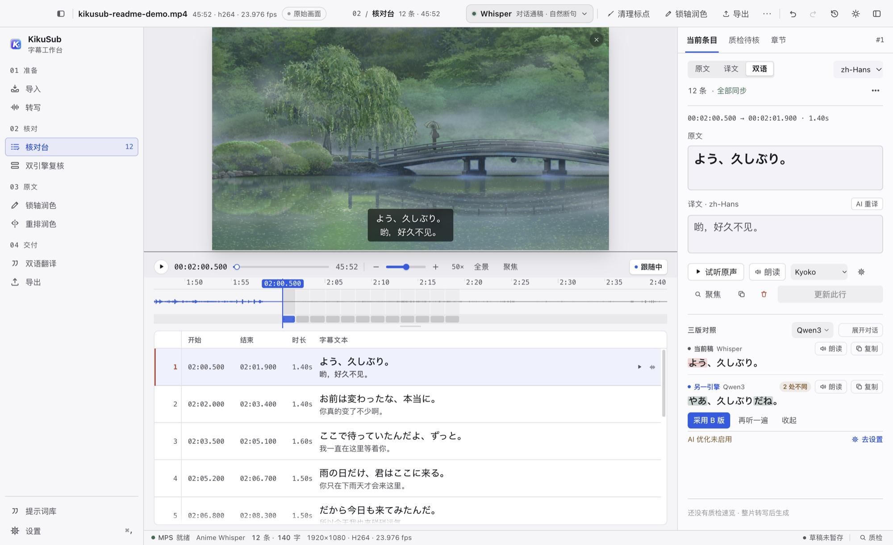
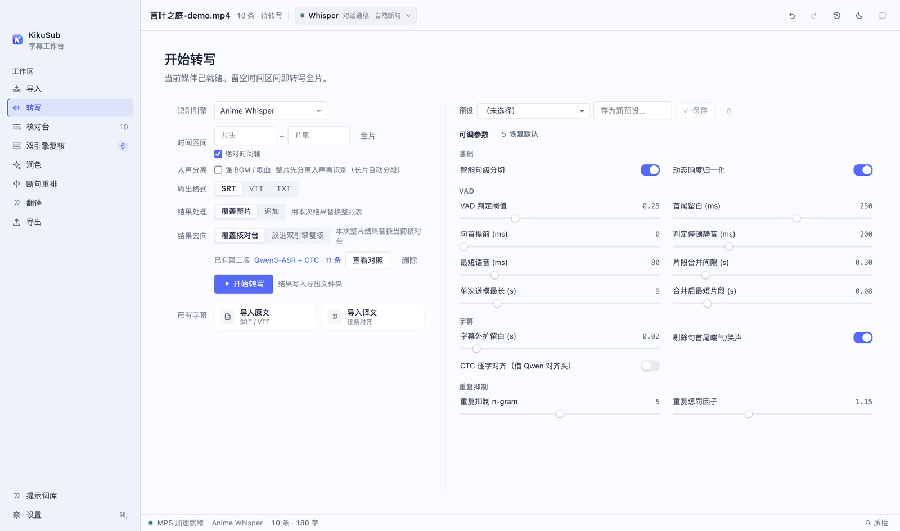
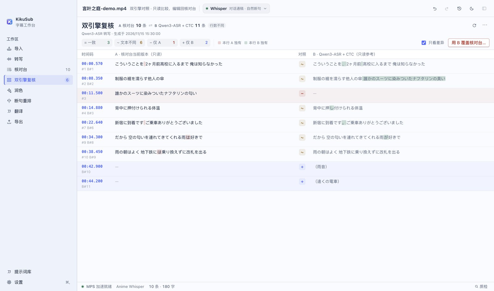
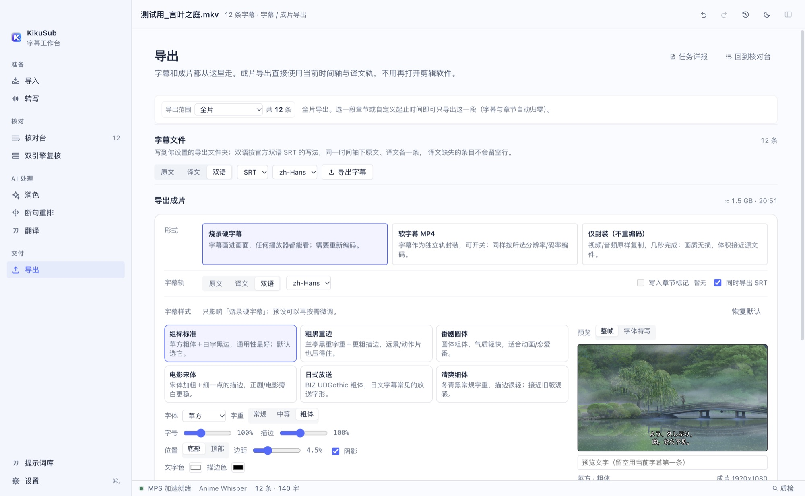
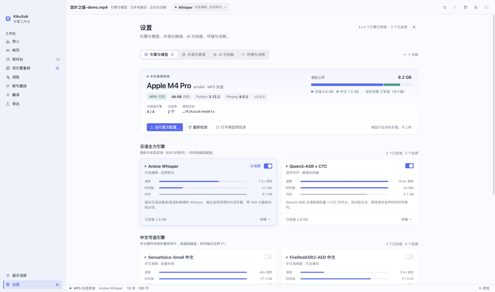

<p align="center">
  
</p>

<h1 align="center">KikuSub</h1>

<p align="center">
  The local subtitle workbench for Japanese film, TV and raw video — built for your Mac.<br>
  <sub>From recognition and listening-based fixes to a finished bilingual video, all on your Mac.</sub>
</p>

<p align="center">
  Apple Silicon native · your audio and video stay on your machine · download and go · free and open source
</p>

<p align="center">
  <a href="LICENSE"></a>
  <a href="https://github.com/Alansws/KikuSub/actions/workflows/ci.yml"></a>
  
  
  <a href="README.md"></a>
</p>



> The footage is a *The Garden of Words* demo clip, showing the Japanese source, Chinese translation and frame-by-frame waveform review.

---

## What KikuSub is for

Plenty of tools turn speech into text, but they tend to stall in three places when the material is Japanese anime, drama, film or a Galgame recording: breathy interjections get swallowed, subtitles pop up two seconds early, and unless your Japanese is good, you are staring at a wall of kana with no way to check it. KikuSub is built around those three problems.

### 1. Made for Japanese dialogue: with background music, breaths and fast speech, the timeline still lands on the first syllable



- **Two main Japanese models, each doing its own job**: Anime Whisper is strong on long conversations and natural flow, the right first pass for a full script; Qwen3-ASR pins each syllable's start and end for the fine timing and final masters where the timeline matters most. Both run locally.
- **Fixes both early subtitles and swallowed words**: silence boundaries are calibrated for the quiet interjections and dense BGM typical of Japanese film and TV, pulling a drifting cue start back to where the character actually speaks, so a single breath does not become a two- or three-second blank cue.
- **Flags what it isn't sure about**: lines that are too quiet, possibly missing, or only a breath or laugh are collected in the QA queue, so you can audition and patch them one by one instead of accepting a made-up line.

### 2. Your Japanese doesn't have to be perfect: two engines check each other, and a "misheard" hint lets AI restore the line



- **Hear each line twice, and only look at the real disagreements**: the other engine's transcript sits in a second column. Commas, ellipses and other irrelevant punctuation differences are filtered out by default, so only lines where the words genuinely differ get highlighted. Click once to audition the original and swap in the other version; changed your mind? `⌘Z`.
- **Can't hear it? Just describe it**: when neither engine gets a breathy word right — or the whole line is blank — type what you heard (a misheard kana or romaji hint, e.g. "sounds like sugoi / very quiet") into the side panel, and the AI uses three lines of context on each side to recover the most plausible Japanese.
- **You always make the call**: AI corrections, polish and translations arrive as side-by-side proposals; nothing overwrites your script on its own. If you are working with sensitive dialogue or want a fully offline run, point single-line correction at local LM Studio / Ollama and no cloud service is involved.

### 3. From subtitles to a chaptered bilingual video in one app



- **Real bilingual output and ready-made styles**: six built-in font presets (fansub standard, anime rounded, Japanese broadcast, film serif and more) previewed directly on the current video frame. Bilingual SRT follows the standard layout — source and translation as two cues over the same timeline — so re-importing never mashes them into one line.
- **No need to open an editor to burn subs**: burn in hard subtitles, package a soft-subtitle MP4 you can toggle, or remux in seconds without re-encoding. Chapters and cue points you set in the review desk are written into the container, so IINA and similar players can jump by chapter.
- **Download and go, no command line**: the packaged app includes every audio/video component it needs — no Homebrew, no environment setup. On first launch, pick a Japanese model and start.

---

## One film, end to end

| 1. Import | 2. Transcribe | 3. Review & translate | 4. Export |
| --- | --- | --- | --- |
| Drag in video, audio or existing subtitles. For MKV / HEVC files the browser engine cannot play, one click in the black frame builds a lightweight viewing proxy | Pick "Japanese natural dialogue" or "Per-syllable precise timeline", and enable "strong BGM / song vocal separation" or just transcribe a range as needed. Detailed parameters stay in a drawer at the bottom until you need them | Drag the waveform in the review desk to adjust timing, or switch to dual-engine review and the AI pages for proofreading, re-segmentation and Chinese translation | Export SRT / VTT / TXT, or render a finished video at your chosen resolution and bitrate with bilingual subtitles and chapters |


---

## Compared with the usual routes

| | **KikuSub** | Traditional subtitle editors (Aegisub etc.) | Online AI subtitle sites |
| --- | --- | --- | --- |
| Japanese speech and breaths | Two engines tuned for Japanese film + onset alignment | All manual typing and timing | General models; breaths and quiet lines get dropped |
| Rescuing an unclear line | Second-engine comparison + misheard-kana hints with context | Slow it down and guess | Edit by hand in a web form |
| Review experience | Video + zoomable waveform + 50-step unified undo + QA queue | Dated UI, fiddly waveform and video setup | Mostly a plain table; frame-accurate timing is hard |
| AI polish / translation | Cloud API, local LLM, or free copy-paste to a web AI | Export the text and wrestle with prompts | Upload your footage / audio to someone's server |
| Privacy and cost | Fully local, free and open source; no account, no per-minute billing | Free | Billed per minute; your media leaves your machine |



---

## Download and use

### Requirements

- **Computer**: Apple Silicon (M1 / M2 / M3 / M4) Mac, macOS 12 or later
- **Disk space**: 15 GB recommended (the two main Japanese models total about 6.6 GB, plus proxy cache and rendered videos)
- **Memory**: 8 GB is enough for single-engine transcription (Anime Whisper peaks around 6.7 GB, Qwen3-ASR around 5.1 GB). A "dual-engine sequential run" requires 12 GB or more; with less, it is refused before the job starts rather than running out of memory halfway.
- **No prerequisites**: the release build bundles its audio/video components — **no Homebrew or ffmpeg install needed**.

### Installation

1. Download the latest release from [Releases](https://github.com/Alansws/KikuSub/releases) and drag `KikuSub.app` into Applications.
2. **First-launch approval**: the app is ad-hoc signed and not notarized. If macOS blocks the first launch, right-click the app icon and choose Open, or run this once in Terminal:
   ```bash
   xattr -dr com.apple.quarantine /Applications/KikuSub.app
   ```
3. **Choose a model**: first launch asks where to store models and recommends one main Japanese model to get started (downloads use a mirror by default on mainland networks and support resume; set `HF_ENDPOINT` to connect to Hugging Face directly).

---

## Advanced features and developer docs

If you are a heavy-tuning fansub user, run local LLMs, or want to build from source and contribute, expand the sections below.

<details>
<summary><b>Transcription and listening details (VAD, vocal separation, dual-engine runs, optional Chinese engines)</b></summary>

- **Choose between two segmenters**: WhisperSeg by default, which has very few false detections on background music and ambience (~114 MB download on first use), or Silero 20s. The expert drawer exposes every tuning parameter — threshold, silence detection, merge gap, n-gram repetition suppression and more (18 of them for Anime Whisper) — plus several presets bound to each engine.
- **Vocal separation (Demucs)**: for singing-only or noisy live audio, enable separation. By default only the separated vocal drives segmentation while recognition still hears the original to preserve Japanese voiceless consonants; switch to "recognise the separated track" when singing completely covers the voice. Long films are chunked to cap peak memory.
- **Dual-engine sequential run**: on machines with ≥ 12 GB RAM, one job can run the primary and secondary engines one after the other. The primary script goes to the review desk, the secondary to the comparison column, and credible lines missing from the primary are sent to the QA queue automatically (up to 50).
- **Ranges and resume**: transcribe only a chosen time range while keeping the film's absolute timeline (the default "replace selection" leaves the rest of the subtitles untouched). Cancel mid-run and the finished part is written to `*.part_cancelled.srt`.
- **Optional Chinese engines**: SenseVoice-Small (~230 MB) and FireRedASR2-AED (~1.35 GB, with punctuation restoration) are built in, disabled by default; download and enable them under Settings → Engines & models.
- Engine capability notes live in [`core/engines.py`](core/engines.py); segmentation and alignment evaluation tools are in [`tools/eval/score_srt.py`](tools/eval/score_srt.py).

</details>

<details>
<summary><b>Review desk productivity (shortcuts, voice-clone read-aloud, chapter markers)</b></summary>

- **Smooth viewing and precise editing**: click to seek; drag more than 4 px to start a selection. Click a table row or a cue block to select its time range; `Esc` clears only the time selection and keeps the current row. Zoom and playhead position are remembered per film (last 50).
- **Common shortcuts**: `←` / `→` step by frame at the real frame rate, `⌘←` / `⌘→` step by one second, `Q` / `E` set in / out, `W` split the subtitle, `⇧Space` audition the current line, `N` snap to the nearest edge, `⌘F` find and replace, `⌘⇧L` clean up punctuation in bulk, `⌘1`…`⌘8` switch work views, `⌘K` rebinds everything.
- **One 50-step undo line**: subtitle add/delete, timing drags, AI adoption, QA state and export settings share one history; click any step to jump there, or `⌘Z` to go back.
- **Voice reference and character voice cloning**: macOS system Japanese voices read lines aloud by default; or take a 3–10 second sample of a character from the video and clone it zero-shot with the local OmniVoice model (downloaded on demand, unloaded after 5 idle minutes).
- **Chapters and cue points**: insert a cue point at the playhead or turn a selection into a chapter at any time; they appear as bands and flags on the waveform, can be written into the MP4 / MKV container on export, and a single chapter can be exported with the timeline rebased to zero.

</details>

<details>
<summary><b>AI processing, data privacy and local LLM overrides</b></summary>


- **Strict timeline protection**: whether proposals come from a built-in API or a web model pasted back in, AI proposals carry no timestamps — the app fills text back by source fingerprint (`digest`) and cue index, so proposals expire automatically once the source subtitles change and can never land in the wrong place. To re-split lines and timing, use the dedicated "Re-segment" lane.
- **Switch channels freely**: with no API key configured, the app defaults to "External manual", which batches prompt copying and aligns pasted results by timestamp on the way back (it does not require the web model to return the exact same number of lines).
- **Local key security and independent judgement override**: API keys are encrypted with a local master key using AES-256-GCM. Under Settings → AI & skills → Advanced, single-line judgement can point at its own local model (e.g. an uncensored fine-tune in LM Studio / Ollama) with automatic calibration of `2048 / 4096 / 8192` context tiers, independent of the global polish / translation configuration.
- **Agent skill**: install with one click to `~/.agents/skills/kikusub-subtitle` and generate standard polish or translation proposals from the current subtitle file in an external AI assistant (contract: [`docs/contracts/ai-proposal.md`](docs/contracts/ai-proposal.md)).


</details>

<details>
<summary><b>Run from source, build and test (for developers)</b></summary>

**Project layout**

```text
core/       algorithm core (no UI dependency): VAD, recognition, segmentation, CTC alignment, proposal validation, export
server/     FastAPI service layer (the Electron sidecar)
desktop/    Electron main process + Svelte 5 renderer
tools/      evaluation harness, packaging scripts (including static ffmpeg fetch and verification), windowless screenshot regression
docs/       domain contracts and release process
tests/      pytest regression tests
```

**Set up a development environment**

```bash
python3 -m venv .venv && source .venv/bin/activate
pip install -r requirements.txt
cd desktop && npm install && cd ..
brew install ffmpeg                    # needed for development only

cd desktop && npm run build && npm start
```

> The service layer can also run on its own: `python -m server --port 0`. Engineering rules and windowless automated verification are in [`AGENTS.md`](AGENTS.md); the release process is in [`docs/release.md`](docs/release.md).

**Package a standalone .app and verify it**

```bash
bash tools/pack/fetch_ffmpeg.sh        # first build: fetch the bundled static ffmpeg / ffprobe (~130 MB)
bash tools/pack/rebuild.sh --no-open   # build sidecar and renderer, assemble and ad-hoc sign the .app
bash tools/pack/verify_bundled_ffmpeg.sh
```

**Run the tests**

```bash
source .venv/bin/activate
pytest -q && ruff check .
cd desktop && npm run check && npm run check:svelte && npm run test:main
node tools/shots/verify_reshape_flow.mjs
```

</details>

---

## License

KikuSub itself is open source under the [MIT](LICENSE) license. AI model weights follow the licenses of their respective upstream repositories; only process audio/video material you have the right to use.

The distributed `.app` bundles static `ffmpeg` / `ffprobe` builds from the [Martin Riedl Build Server](https://ffmpeg.martin-riedl.de/) (FFmpeg 9.1, **GPLv3**). The full license text, source and sha256 verification information are included in `Contents/Resources/bin/` (see [`docs/contracts/desktop-lifecycle.md` §3.8](docs/contracts/desktop-lifecycle.md)); upstream source is at [ffmpeg.org](https://ffmpeg.org/download.html).
