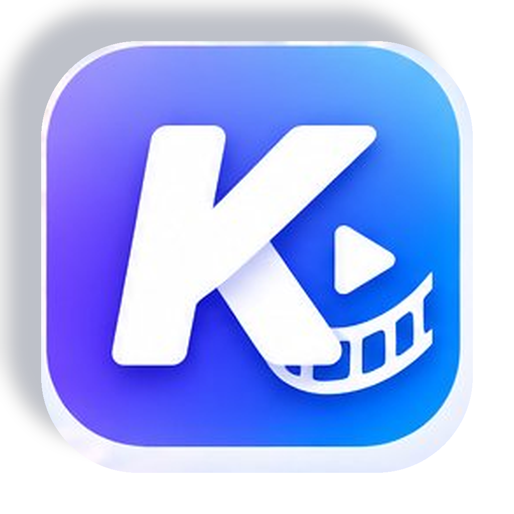
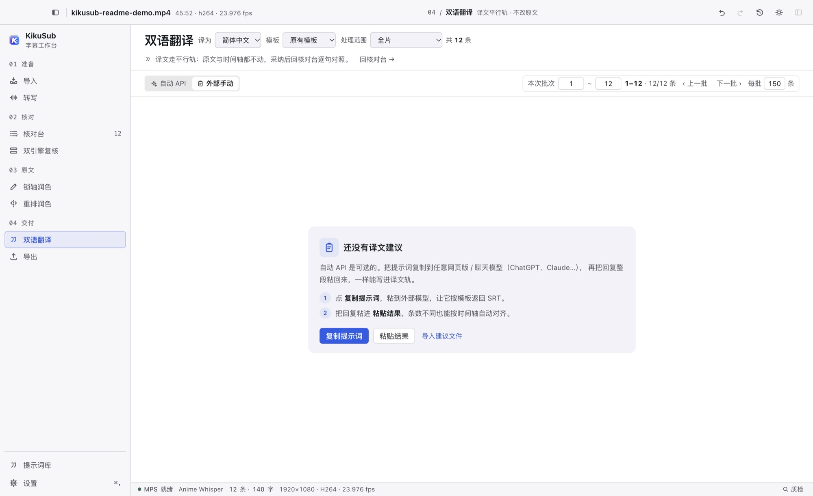
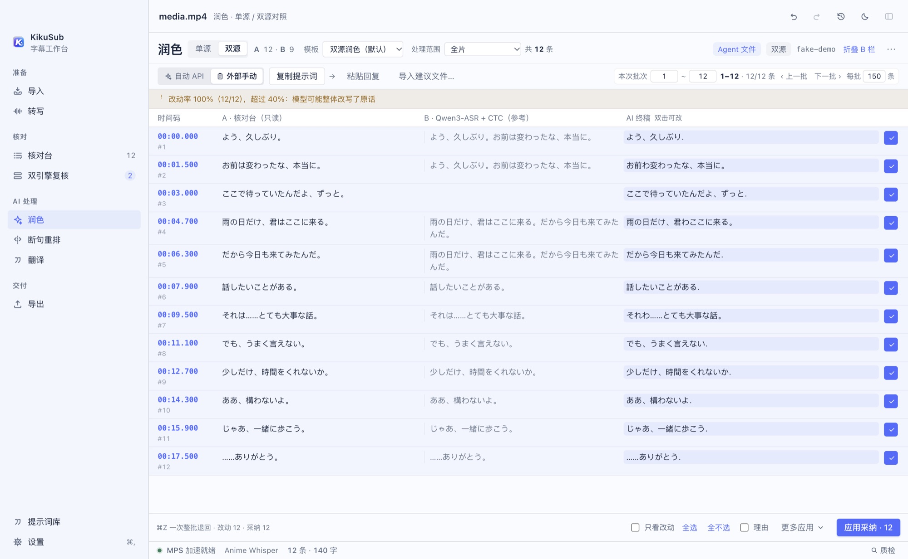
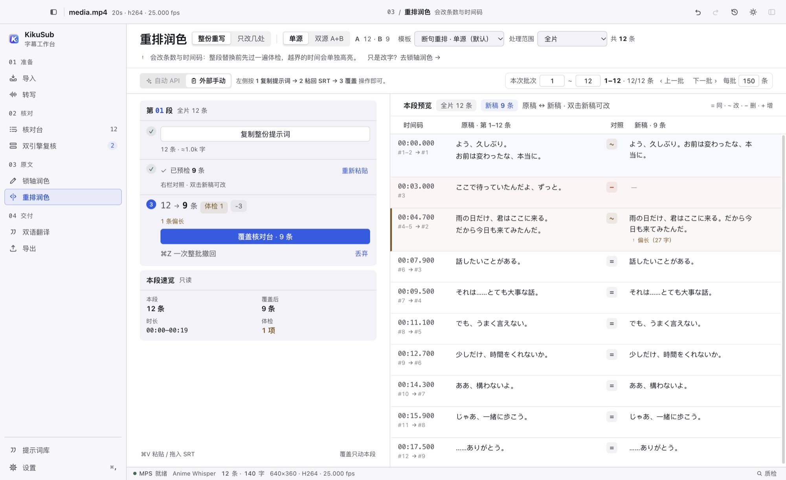
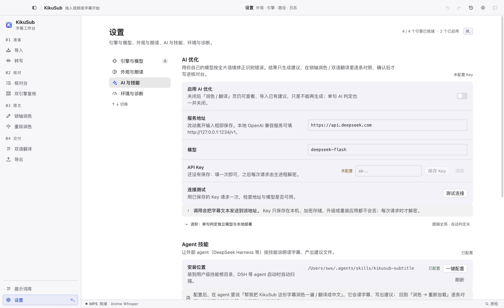

<p align="center">
  
</p>

<h1 align="center">KikuSub</h1>

<p align="center">
  Turn a raw Japanese video into subtitles you can actually ship — entirely on your own Mac.<br>
  <sub>Hear every line. Hit every frame.</sub>
</p>

<p align="center">
  macOS desktop app (Electron + Svelte shell · Python core) · Apple Silicon native · fully on-device · <b>no ffmpeg install needed</b> · MIT
</p>

<p align="center">
  <a href="LICENSE"></a>
  <a href="https://github.com/Alansws/KikuSub/actions/workflows/ci.yml"></a>
  
  
  <a href="README.md"></a>
</p>


> Screenshots are rendered silently by the app itself (no window). Footage and subtitles are *The Garden of Words* demo data: source line, Chinese translation, and a second engine's take.

---

## Three things nothing else does this way

### 1. Built for Japanese footage: breathy lines, BGM and fast speech — the timeline still bites the first syllable


- **Two Japanese engines, each with a job**: Anime Whisper favours natural, connected dialogue (first pass); Qwen3-ASR carries a CTC alignment head (40 ms per-character resolution when the timeline matters). Both run on your machine.
- **Breaths are a hard requirement**: VAD defaults to WhisperSeg (near-zero false positives on BGM / ambience) and detects in windows so a long film does not drift; a cue's leading silence is **pulled forward to the actual onset using audio evidence**, so an "ah…" does not become a subtitle that appears two seconds early and stretches.
- **It admits uncertainty**: the QA queue separates "audio with no text", "text the verifier dropped", "suspiciously short", "only breaths / laughter", and "the secondary engine had it", so you audition and patch each one instead of trusting the whole transcript.

### 2. Bad at Japanese? Still fixable: misheard-kana clues + context let AI restore what you missed


- **Hear the same line twice**: the other engine's full transcript lands in a read-only column, aligned row by row with per-character markers (`=` / `~` / `+` / `−`). Audition and **adopt B** right in the row; one ⌘Z reverts. Punctuation and whitespace differences are ignored by default, so real disagreements are not buried under false positives.
- **When you cannot hear it, let AI look at it**: if the two versions disagree, AI judges a "third version" using three lines of context on each side; if they agree, it reviews; if only one exists, it corrects; **if both are empty, it can still recover the line** from a listening clue (what the kana / romaji sounded like) plus context.
- **It never decides for you**: AI output is only a proposal. Adopting it is an ordinary subtitle edit (⌘Z undoes it), stale results expire when A/B or the timing changes, every judgement can be read aloud with TTS, and follow-ups open in a draggable window.

### 3. Fully offline, free and open source: bilingual exports and one-click burned-in video, no editor required


- **Bilingual means bilingual**: official bilingual SRT layout (source and target as separate cues over the same time range), so re-importing never collapses the two lines.
- **Finishing is one click**: hard subs use a Pillow sprite + ffmpeg overlay and **do not depend on libass**; soft subs are toggleable in MP4; "copy only" skips re-encoding. Chapters and cue points can be written into MP4 / MKV so IINA and friends can jump by chapter.
- **Download and run**: the app ships arm64 static ffmpeg / ffprobe (FFmpeg 9.1, GPLv3 — source and sha256 in [`NOTICE-ffmpeg.txt`](docs/contracts/desktop-lifecycle.md)). **No Homebrew, no `brew install ffmpeg`.** Model weights are not bundled: download the one you use on first run.

---

## Four steps, one film

| ① Import | ② Transcribe | ③ Review / AI | ④ Deliver |
| --- | --- | --- | --- |
| Drag in video / audio / subtitles. For MKV or HEVC that Chromium cannot play, one click in the black frame makes a 480p viewing proxy (never silently in the background) | Pick an engine; leave the range empty for the whole film. Expert parameters live in a drawer at the bottom until you open it | Waveform + video + table + inspector, linked. Dual-engine review, AI polish / translate / re-segment | SRT / VTT / TXT, or a finished video with subs; bilingual and chapters included |



---

## Compared with the usual routes

Automatic subtitles are table stakes now. KikuSub differs in the **second half**: can it hear breathy Japanese, does the timing hold, how do you converge when two engines disagree, and can you hand over the finished file.

| | **KikuSub** | General subtitle editors (Aegisub / Subtitle Edit kind) | Cloud subtitle services |
| --- | --- | --- | --- |
| Japanese speech, breaths, laughter | VAD in windows + onset pull-back + two Japanese engines | Type it yourself, time it by ear | General models; breaths get dropped, boundaries are coarse |
| In-cue timing | Anime Whisper assigns inside VAD spans; Qwen3 aligns per character (40 ms) | All manual | Mostly sentence-level; you re-time afterwards |
| Second opinion | Row-by-row diff against another engine, audition / adopt inline | None | None |
| Review loop | Waveform + 50-step history + ⌘F find & replace + QA queue | Yes, but through an external player | Edit line by line in a browser; cannot drag timings |
| AI polish / translate | Built in; can point at local LM Studio, or paste to any web model | You assemble the prompts | Built in, but your media is uploaded |
| Delivery | Bilingual subtitles + burned-in video + chapters | Subtitles only | Subtitles only; another tool for video |
| Privacy / price | Fully local, MIT, free, no account | Free | Priced per minute |


---

## Install

### Requirements

- macOS 12 or later, **Apple Silicon (arm64)**
- **No ffmpeg / Homebrew needed** — the app bundle ships static ffmpeg and ffprobe
- Disk: ~6.6 GB for both Japanese models, ~1.4 GB more for the optional Chinese engines; 15 GB recommended
- RAM: 8 GB (Anime Whisper peaks around 6.7 GB, Qwen3 around 5.1 GB); **sequential dual-engine runs require ≥ 12 GB** and are refused before they start rather than failing mid-run

### Use the packaged .app

Prebuilt packages are on [Releases](https://github.com/Alansws/KikuSub/releases). Drag `KikuSub.app` into Applications.
The app is ad-hoc signed and not notarized, so Gatekeeper blocks the first launch: right-click → Open, or

```bash
xattr -dr com.apple.quarantine /Applications/KikuSub.app
```

**First launch** is two steps: pick a model directory (default `~/Library/Application Support/KikuSub/models`) →
choose the Japanese engines. Anime Whisper (dialogue) and Qwen3-ASR (per-character timing) are recommended;
Chinese engines and OmniVoice voice cloning sit under "More optional add-ons". Weights are not bundled,
downloads default to `hf-mirror.com` with resume support; set `HF_ENDPOINT` to use Hugging Face directly.

### Run from source

```bash
python3 -m venv .venv && source .venv/bin/activate
pip install -r requirements.txt
cd desktop && npm install && cd ..
brew install ffmpeg                    # only for development builds; the packaged app uses its bundled binaries

cd desktop && npm run build && npm start   # shows a window; automated verification uses --screenshot (AGENTS.md §0.5)
```

The sidecar can also run alone: `python -m server --port 0` prints `{"event":"ready","port":…,"token":…}` on the first line.

### Build the .app

```bash
bash tools/pack/fetch_ffmpeg.sh    # first time: fetch the pinned, sha256-verified static ffmpeg (~130 MB, not in git)
bash tools/pack/rebuild.sh --no-open   # rebuild sidecar if needed → build renderer → assemble + ad-hoc sign, never opens a window
```

After changing Python in `core/` / `server/`, rebuild the sidecar first — `build_app.sh` refuses to assemble when the sidecar is older than the sources.
To prove the bundled binaries really work (packaged sidecar, PATH without Homebrew):

```bash
bash tools/pack/verify_bundled_ffmpeg.sh
```

### Tests

```bash
source .venv/bin/activate
pytest -q                              # core, server, AI proposals and translation track
ruff check .
cd desktop && npm run test:main        # main process: cleanup, key storage, skill install
node tools/shots/verify_reshape_flow.mjs   # behavioural regression in the real UI, windowless
```

---

<details>
<summary><b>Transcription internals you can tune (VAD, dual-engine runs, source separation…)</b></summary>

- **VAD backend**: WhisperSeg (default, near-zero false positives on BGM / ambience, ~114 MB on first use) or Silero 20s (compatibility, no weights). Threshold, silence floor, minimum speech, merge gap and max segment length all live in the expert drawer; the recommended calibration for the active backend (WhisperSeg 0.35 / Silero 0.25) is shown next to the threshold and can be applied in one click.
- **Each of the four engines carries an engine-bound preset** (Japanese ASMR × 2, Chinese short-form × 2); the dropdown only lists presets valid for the current engine, and cross-engine loads are rejected.
- **Dynamic loudness normalisation** (`dynaudnorm`) is on by default: quiet masters otherwise turn whole stretches of dialogue into empty segments.
- **Source separation** (Demucs htdemucs): whole film or any range. By default only the clean vocal is used for VAD while recognition still hears the original (Japanese consonants do not get dulled); switch to "separated vocal for recognition" when singing fully covers speech. Long films are chunked, so peak RAM follows chunk length, not film length.
- **Sequential dual-engine run**: one job runs the primary engine (main script → review desk), releases it, then runs the secondary on the same audio into a read-only second column; lines the primary lacks pass an overlap + similarity filter into the QA queue as gap-fill suggestions (up to 50). A RAM gate sits between the passes; primary and secondary swap with one click.
- **Result handling by scope**: whole film offers overwrite / append, a range adds "replace selection" (default, rewrites only that range). Cancel mid-run and the finished part is written as `*.part_cancelled.srt`.
- **Optional Chinese engines**: SenseVoice-Small (~230 MB, token timestamps) and FireRedASR2-AED (~1.35 GB, FireRedPunc punctuation), both via sherpa-onnx on CPU, disabled by default and downloaded on demand.
- Engine capabilities are declared in [`core/engines.py`](core/engines.py); any change to segmentation must be backed by [`tools/eval/score_srt.py`](tools/eval/score_srt.py) numbers (CER / split words) on the same range.

</details>

<details>
<summary><b>Review desk: keyboard work, 50-step history and the QA queue</b></summary>

- **Click to seek, drag past 4 px to select**; clicking a table row or a cue block (no drag) sets the time selection to that cue's exact range. `Esc` clears only the selection and keeps the current row and multi-selection.
- **Work state is remembered per film**: zoom / playhead / selected row / selection for the 50 most recent files, so switching views, films or restarting the app returns to exactly where you were. Long films open on cue 1 at roughly 50× and switch to bilingual by default when a translation track exists.
- **Keys**: `←` / `→` frame step (real fps), `⌘←` / `⌘→` one second, `Q` / `E` in / out at the playhead, `W` split, `⇧Space` audition to the end of the cue, `N` snapping, `⇧Z` full film / back, `1`–`3` speed; `⌘1`…`⌘8` switch views, `⌘K` rebinds, `⌘F` find & replace, `⌘⇧L` punctuation cleanup.
- **One history line**: subtitles, translations, QA state, export settings and AI suggestions share a ≤50-step `WorkspaceState`; every step names what it did, clicking any step jumps back, and ⌘Z always undoes the most recent action.
- **QA queue**: `missed` / `dropped` / `suspect` / `coverage` / `nonverbal` / `ensemble`, each auditable, patchable and persisted to `*.qa.json`. It lives in an inspector tab and can pop out as a draggable window.
- **TTS reference**: macOS system Japanese voice by default (no VRAM); upload reference audio, slice from the current cue, or right-click any line to create an OmniVoice zero-shot clone. Saved voices live in a library with audition, default, rename and delete. Synthesis is loudness-matched (−18 LUFS / −1.5 dBTP).
- **Chapters / cue points**: type a title and press Enter; flags and bands appear on the waveform ruler, click to jump, and every add / edit / delete is a single ⌘Z, persisted per film fingerprint.

</details>

<details>
<summary><b>AI pipeline: one proposal contract, two execution channels</b></summary>



- **Translate / polish / re-segment share one toolbar**: row 1 is mode, template and scope; row 2 is the execution channel — **[ Auto API | Manual ]**.
- **Both channels produce the same artefact**: a proposal file. Generated in-app or by an external agent, the UI is identical. The proposal carries **no timestamps** — the app joins them back by index, so "the timeline does not change" is structural rather than a prompt promise.
- **Manual is the honest path without an API key**: copy the prompt, paste it into any web model, paste the reply back; differing line counts still align by time range (with an optional strict-count switch). With no proposal you get a 1-2 step guide, not an empty page.
- **Scope and batches**: whole film / chapter range / custom range, then an optional index batch (N at a time); copy, paste-back and apply only touch that batch.
- **Contract**: a mismatched source fingerprint (`digest` / `digest_b`) is rejected outright — not a byte of the subtitles is touched; applying a batch is one history step. Details in [`docs/contracts/ai-proposal.md`](docs/contracts/ai-proposal.md).
- **Re-segmentation** is the "whole script swap" lane: line count, splits, timing and text can all change; checks only warn (overlap / reversed / too long / out of range) and require confirmation only when the line count halves.



<details>
<summary>AI channel details: local LM Studio, arbitration overrides, context tiers</summary>



- Global config is three fields: Base URL, model, API key (encrypted with a local master key, AES-256-GCM, stored in `preferences.json`; never in logs or `settings.json`).
- **The single-sentence arbitration lane can point somewhere else entirely** (separate Base URL / model / key): fix it to a more permissive local model, including community uncensored fine-tunes, while polish / translate keep the global endpoint.
- **Context tiers 2048 / 4096 / 8192 apply to loopback endpoints only**: a lightweight probe runs before judging, and the model is reloaded at the chosen tier only when it is not already loaded at that tier — otherwise it is a no-op.
- **Auto-judge** ("AI-judge when the two versions differ") is off by default; when on, the same line with the same B text runs once, and switching lines / editing text / collapsing the card / cancelling aborts the in-flight request.
- The bundled Agent skill installs to `~/.agents/skills/kikusub-subtitle`; tell DeepSeek Harness "polish this subtitle file" and it writes a proposal only — it never edits the subtitles.

</details>

</details>

<details>
<summary><b>Export: subtitle styling, clip ranges and naming</b></summary>

- **Three forms**: burned-in hard subs (re-encode), soft-sub MP4 (toggleable track), copy-only (no re-encode, seconds).
- **Six style presets** (Group standard / Heavy outline / Anime rounded / Film serif / Japanese broadcast / Clean light), plus per-field control of font, weight, size, outline, shadow and position; the preview renders on the current video frame and can zoom into the glyphs.
- **Clip export**: whole film / chapter range / custom range, with timeline re-based to zero, chapters and cue points shifted, and a `.chapter1-00m10s-24m22s` tag in the filename. Copy-only for a clip cuts at keyframes (use burn-in or soft subs for frame-accurate cuts).
- **Delivery naming**: `film.AnimeWhisper.reviewed.srt`, `…reviewed.zh-Hans.srt`, `….bilingual.srt`; same name with different content becomes `(2)`, so versions from different engines never overwrite each other.
- Export settings (form / track / resolution / bitrate / style) and "export again" all share the same undo history.

</details>

---

## Project layout

```text
core/       algorithm core (no UI): VAD, ASR, segmentation, alignment, proposals, translation, export
server/     FastAPI service layer: /api/*, /media/*, /ws/jobs/* — the Electron sidecar
desktop/    Electron main process + Svelte 5 renderer (eight views + settings)
tools/      eval harness, packaging (including bundled ffmpeg), windowless screenshots and regressions
docs/       development docs, domain contracts and execution records
tests/      pytest regressions (core / server / AI lanes)
```

- **Engineering rules** (core boundary, one history line, big files may only shrink, never open a window…) are in [AGENTS.md](AGENTS.md);
- **Domain contracts** are indexed in AGENTS.md §3, details under [`docs/contracts/`](docs/contracts/);
- **Release process** is in [`docs/release.md`](docs/release.md), including how the bundled ffmpeg is fetched and verified.

## License

[MIT](LICENSE). Model weights follow their own repositories' licenses; only process material you have the right to use.

The ffmpeg / ffprobe binaries bundled in the app are **GPLv3** static builds (FFmpeg 9.1, from
[Martin Riedl's build server](https://ffmpeg.martin-riedl.de/)). The full license text, build
configuration, source URL and sha256 are shipped inside `Contents/Resources/bin/` and documented in
[`docs/contracts/desktop-lifecycle.md` §3.8](docs/contracts/desktop-lifecycle.md); upstream source is at
[ffmpeg.org](https://ffmpeg.org/download.html).
