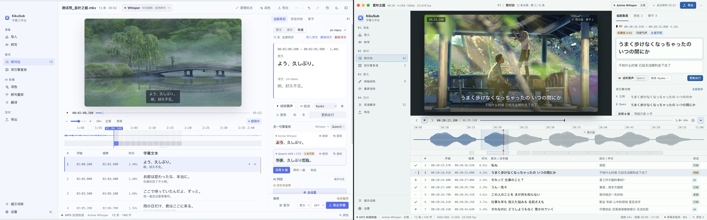

# KikuSub 前端重塑（2026-11）

> **状态：Step 2 已拍板（Cue Script 通过）；Step 3 进行中——令牌 / 外壳 / 转写页样板间。**
>
> 本轮不是“把现有页面修漂亮”，而是换一套**界面语言 + 页面骨架 + 任务顺序**。
> 视觉世界叫 **Cue Script（录音台本）**；完整令牌与组件规则见根目录 [DESIGN.md](../DESIGN.md)，
> 产品事实见 [PRODUCT.md](../PRODUCT.md)。

## 0. 新会话从这里开始

**5 分钟读法**：§0.1 看红线 → §1 看当前状态 → §2 看不可动摇的用户路径 → §7 看下一步 → §8 跑验收命令。
**不要做**：不要动 `core/`、`server/`；不要打开任何窗口（§8.3）；不要覆盖用户本机现役的
`KikuSub.app` 或其 `settings.json` / `userData`（§0.1）。
**产物位置**：本文是主台账；截图在 [images/refactor-2026-11/](images/refactor-2026-11/)；原型在
工作区 `.impeccable/prototype/`（不在仓库内，不随包发布）。

### 0.1 铁律：与现役旧版双开共存，绝不覆盖

用户的日常主力是**本机当前已安装的旧版 KikuSub**。重构产物必须能在同一台 Mac 上并行存在、
各自双击打开；任何一步都不得污染旧版的安装、配置或运行数据。**四条硬约束**：

1. **不覆盖已安装的 `.app`。** 严禁向 `/Applications/KikuSub.app`、`build/pack/KikuSub.app`
   或任何现役打包路径写入。未来构建试用版必须换**独立的产物名与独立 bundleId**
   （`KikuSub-Next.app` / `com.github.kikusub.next` 之类），让新旧两款可长期共存。
   本仓库现有的打包脚本默认产物就是现役名，**未经用户逐次确认不得运行**。
2. **配置与运行数据隔离。** 新界面的状态（外观偏好、界面缓存、预留的布局记忆）不得写进旧版
   正在使用的 `settings.json`、`presets.json`、Electron `userData` 目录或 `~/.agents/skills/`。
   验证与并行体验一律走**独立数据根**：`KIKUSUB_DATA_DIR` / `KIKUSUB_PREFERENCES_PATH` /
   `--user-data-dir`（见 `tools/shots/` 下各脚本），默认指向系统临时目录。
   渲染层新增的偏好只进 `localStorage`（每个 `--user-data-dir` 天然隔离），不进共享配置文件。
3. **Git 保护。** 只在 `feat/ui-redesign` 上工作；`backup/pre-ui-redesign-2026-11` 与
   `archive/pre-ui-redesign-2026-11-25` 是两个只读锚点，**不删除、不移动、不 rebase**；
   不推远端、不碰 `main`。
4. **不卸载、不重装、不改名旧版。** 不执行 `defaults write`、不改旧版的 Launch Services 注册、
   不动它的签名与图标。新旧共存靠新产物的独立标识实现，不靠改旧版。

## 1. 当前状态

| 项 | 状态 | 证据 / 位置 |
| --- | --- | --- |
| 备份分支 | ✅ 已建 | `backup/pre-ui-redesign-2026-11` @ `74fd5dc` |
| 备份标签（非 `v*`） | ✅ 已建 | `archive/pre-ui-redesign-2026-11-25` |
| 开发分支 | ✅ 已切 | `feat/ui-redesign` |
| 产品事实 | ✅ 已写 | [PRODUCT.md](../PRODUCT.md) |
| 视觉世界 / 设计系统 | ✅ 已写，按拍板更新 | [DESIGN.md](../DESIGN.md) |
| 高保真原型 | ✅ 8 张分页图 + 1 张对比图 | [images/refactor-2026-11/](images/refactor-2026-11/) |
| macOS HIG 审查 | ✅ 初版 | §6 |
| 机械检测 | ✅ 已跑 | `impeccable detect`；见 §5.4 |
| 用户拍板（§9） | ✅ 已确认（2026-11-25） | §9 已冻结为决定，不再是待问项 |
| 旧版共存 / 数据隔离铁律 | ✅ 已写入 | §0.1 |
| 生产代码 | 🚧 Step 3 进行中 | 只动令牌 / 外壳 / 转写页；核对台未动 |
| 旧文档指针 | ✅ 已加 | [ui-refactor-plan.md](ui-refactor-plan.md) / [界面设计优化分析-2026-11.md](界面设计优化分析-2026-11.md) 顶部 |

### 1.1 这轮和上一轮的区别

上一轮（[ui-refactor-plan.md](ui-refactor-plan.md)）是**在既有“青空”皮肤上做 8 个单点优化**；
这一轮是**替换视觉世界 + 重排任务顺序**。两者的关系：

- 上一轮已完成/已作废的项不再重做；它的 Step 1–8 大多已经落地（侧栏分组、专家抽屉、AI 三页统一工作条、
  双引擎去噪、导出/设置收敛）。
- 上一轮未做的 7 条视觉差距（控件高度、圆角、字阶令牌率、动效、断句重排布局、检查器末行、
  设置值列）不再单独开题，统一收进本轮的设计系统。
- 旧文档保留为历史记录，**不按它继续改代码**。

## 2. 底线：用户的功能逻辑顺序

### 2.1 灵魂路径

```
导入 → 转写 → 核对台 → 双引擎复核
                     → 原文加工：① 锁轴润色 → ② 重排润色
                     → 交付：③ 双语翻译 → 导出
```

三个原则：

1. **每一步只回答一个问题**：我现在在哪、这一步要做什么、做完之后去哪。
2. **主操作永远在内容里**，不在底栏、不在“更多”菜单里；底栏只放只读状态。
3. **顺序不是装饰**：侧栏分组、页面标题、下一步按钮、空态文案必须说同一件事。

### 2.2 命名决定

| 旧名 | 新名 | 它真实做什么 | 风险 |
| --- | --- | --- | --- |
| 润色 | **锁轴润色** | 1:1 改文字，条数与时间码不动；`apply_polish()` 保护时间轴 | 低 |
| 断句重排 | **重排润色** | 可改条数、断句与时间码；整段替换 SRT，带体检与越界警告 | 高（动轴） |
| 翻译 | **双语翻译** | 生成/回填译文平行轨，不改原文 | 中 |

**为什么“锁轴 / 重排”这两个词是对的**：它们把“改不改时间轴”这个真正的分界说出来了。
用户不需要先理解 digest、SRT 替换或结构校验，只需要知道“这一页会不会动我的轴”。

### 2.3 合并还是两页：建议两页

用户提出的“1 和 2 合并成一个「原文润色」页内切换”是合理的直觉，但**本轮建议两页**，理由按重要性排序：

1. **数据契约不同。** 锁轴是 1:1，服务端只接受同条数的文本；重排是整段 SRT 替换，
   条数、切分、时间码都可变。把它们塞进一个页面的两个模式，等于把两套校验、两套失败态、
   两套历史入口装进同一个组件，最容易出现“以为在润色，其实在重排”。
2. **风险等级不同。** 重排会动轴；它需要体检、越界警告、条数腰斩二次确认。锁轴不应该
   继承这些红色警告，否则用户会以为“改个字也有风险”。
3. **工具不同。** 锁轴的核心是 A/B/AI 三栏逐条对照；重排的核心是粘 SRT、分段计划、体检。
   两者的主视区、头部、底部应用条不是同一套。
4. **用户的心智是递进，不是二选一。** 绝大多数人先做锁轴；只有“断句本身错了”才进重排。
   两页 + 编号 + 互相指路，比一个模式开关更符合这个顺序。

**落地方式**（不是两个孤立页面）：

- 侧栏同一组 `03 原文` 下：`锁轴润色`、`重排润色`，标题旁标 `①` / `②` 或直接写“先锁轴，后重排”。
- 锁轴页头写“只改文字，不动时间轴”；右上角一个安静的入口：“需要改断句？→ 重排润色”。
- 重排页头写“会改条数与时间码”；右上角反向指路：“只改文字？→ 锁轴润色”。
- 如果未来数据显示 90% 的用户只用其中一页，再评估合并；现在不合并。

### 2.4 导航：四段，快捷键不动

| 段 | 项 | 快捷键 | 说明 |
| --- | --- | --- | --- |
| 01 准备 | 导入 | ⌘1 | 继续当前工程，或换片 |
|  | 转写 | ⌘2 | 产出 / 范围 / 引擎 / 开始 |
| 02 核对 | 核对台 | ⌘3 | 视频 + 波形 + 字幕表 + 检查器 |
|  | 双引擎复核 | ⌘4 | A/B 差异，只呈现真正不同的行 |
| 03 原文 | 锁轴润色 | ⌘5 | 只改文字 |
|  | 重排润色 | ⌘6 | 可改断句与时间码 |
| 04 交付 | 双语翻译 | ⌘7 | 译文平行轨 |
|  | 导出 | ⌘8 | 字幕 / 成片 |

**关键决定：⌘1–⌘8 的顺序不变**。只改名称与分组（“AI 处理”拆成“原文”和“交付”），
因为主进程菜单、`shortcuts.svelte.ts`、设置页快捷键说明和用户肌肉记忆都绑在这个顺序上。
`重排润色` 仍在 `锁轴润色` 后面，正好符合用户的自然顺序，不需要顺延。

### 2.5 逐页巡检：用户此刻的问题 → 页面怎么回答

| 步骤 | 用户此刻的问题 | 现状断点 | 本轮改法 |
| --- | --- | --- | --- |
| 导入 | “我上次干到哪了？换片还是继续？” | 导入页的主视觉仍是“拖入文件”；已有工程时没有“继续”主操作 | 顶部**继续当前工程**卡（上次位置 / 继续核对），拖入降为第二动作；底部“从导出文件夹继续” |
| 转写 | “这次产什么？跑哪段？用哪个引擎？跑完去哪？” | 完成后主 CTA 只有双引擎场景的“查看差异”；普通完成没有“去核对台” | 右侧“现在的稿”常驻**去核对台**；完成态在结果条里再给一次；上次这一趟可一键载入 |
| 核对台 | “这一句对不对？时间轴要不要动？下一句在哪？” | 检查器 348 px 偏挤；表格被右栏挤窄；视频和表面比例不够稳 | 舞台行（视频 + 388 px 检查器）+ 全宽时间线/表格；cue margin 统一状态；行高 30 不变 |
| 双引擎复核 | “哪几行真的不一样？要不要采用 B？” | 标点噪声已默认过滤；但页头/行内动作与核对台不是同一骨架，行内试听/采用还能更轻 | 保留“忽略标点”；差异行右侧轻量试听/采用；页头与核对台同骨架 |
| 锁轴润色 | “AI 改了什么？会不会动我的轴？怎么退回？” | 与“断句重排”名字太像；锁轴/重排的真正差别只写在正文里 | 改名；页头锁图标 + “时间轴锁定”；A/B/AI 三栏同基线；应用条写明“条数不变” |
| 重排润色 | “改完条数会变吗？时间码会不会错位？” | 名字不说明风险；入口与锁轴混在一起 | 改名；页头明写“会改条数与时间码”；体检/越界警告前置；与锁轴互相指路 |
| 双语翻译 | “译文和原文怎么对？补译会不会覆盖已核对？” | 与“原文润色”混在 AI 处理组；补译入口不够显眼 | 归入“04 交付”；原文/译文/双语三态清楚；补译只写待译条 |
| 导出 | “我该导字幕还是成片？设置会不会丢？” | 页面很长；同一句“暂无译文轨”出现两次；主操作不够跳 | 先给“字幕 / 成片 / 仅封装”三条清楚路径；无译文时一次提示；底部说明收敛 |

### 2.6 跨页接力（这次必须修）

- 转写完成：`状态条 + 去核对台`，不是只给“查看差异”。
- AI 采纳：回到核对台时定位到刚改的那一条，并保留滚动位置。
- 导入：已有工程时先给“继续核对”，再给“换片”。
- 导出：从核对台/双语翻译进入时，带上当前范围与轨道；导出成功后给“打开文件夹 / 回到核对台”。
- 任何失败：错误信息说“哪一句 / 哪个文件 / 怎么恢复”，不弹无信息的 modal。

## 3. 视觉世界：Cue Script

### 3.1 七个候选（按与产品的共振排序）

| # | 世界 | 为什么共振 | 它长什么样 |
| --- | --- | --- | --- |
| 1 | **光学声轨** | 产品的核心是声音与时间；声轨是电影里“声音的形状” | 银盐灰黑、连续波形、一条扫描线 |
| 2 | **字幕校对本** | 产品就是一张校对本：时间码、原文、译文、朱笔 | 冷纸、墨、蓝铅笔、朱笔 |
| 3 | **录音台本** | 配音/字幕前期都用它：条号、时间、台词、备注、检印 | 淡蓝纸、墨、页边记号、朱印 |
| 4 | **新干线运行图** | 时间是连续轴，车次是块，章节是站 | 纸底、墨线、信号红/绿、密集刻度 |
| 5 | **电影片头倒计时** | 帧、秒、片头对位；天然适合播放头 | 黑白、圆环、帧号 |
| 6 | **日语组版 / 原稿纸** | 日文字体、行距、ruby、栏线 | 纸、墨、红色栏线 |
| 7 | **节目表 / EPG** | 时间 × 频道的网格，适合长片 | 密集网格、频道色 |

**被分配的是 #3（录音台本）**。它不是我的第一选择（#1 光学声轨更像“电影”），
但 concept-seed 的分配价值就在这里：它逼我从“最像电影”的直觉里退一步，选一个**更贴近字幕工作本身**的物件。
录音台本同时具备纸、墨、页边、检印四种材料，能给出一套在亮/暗两种光线下都成立的系统，
而且不会滑向“暗色 NLE + 琥珀”的现成答案。

### 3.2 挑战者判定（六个 catalog 世界）

| 挑战者 | 判定 | 保留的一条纪律（donation） |
| --- | --- | --- |
| 登机牌 + 登机口翻牌 | declined | **变更状态要留住**：一句被改过的字幕，在被看到之前一直带标记 |
| 暗色开发者控制台 | declined | **危险动作要隔离**：删除/覆盖离开主按钮，隔一条发丝线和 16 px 空气 |
| 机场黄色导视 | declined | **每个路口只给下一个决定**：右栏只回答“现在去哪”，不是功能清单 |
| 同人展目录 | declined | **整格密度 + 已访问标记**：表格是密集的，但每行都有页边记号 |
| 植物图谱 | declined | **同基线对比**：原文/建议/采用后三栏必须逐行对齐 |
| 可变字体样本 | declined | **实时数字读数**：时间码、缩放、帧率始终是等宽、即时更新的 |

这些纪律都进了设计：cue margin、隔离的删除、右栏“下一步”、三栏对齐、等宽读数。

### 3.3 世界只借四件事

按 Operate 模式的限制，世界只提供**字体、色板、密度、一个签名动作**；导航与控件仍是 macOS 标准件。

- **字体**：系统 SF / PingFang / Hiragino；时间码 SF Mono。
- **色板**：冷纸、墨、蓝铅笔、朱笔；不用琥珀，不用霓虹。
- **密度**：30 px 表格行、11 px 数据、1 px 发丝线、页边 44 px。
- **签名动作**：**cue margin**。左缘 44 px 是台本的页边：已核打勾、AI 蓝铅笔、待核朱点；
  当前句在页边落一道 2 px 朱线，编号转朱。它同时是状态、导航和“校对本”的记忆点。

**为什么不是概念 A/B/C**：那三套是 11-24 的探索稿，用户明确不喜欢；它们也都滑向了
“暗色 NLE + 浮层卡片”的现成答案。本轮不参考它们的配色与布局。

**为什么不是 Final Cut / Linear / IINA 的皮肤**：它们是 craft bar（工艺水平），不是 world。
我们借它们的克制、密度、键盘优先，不借它们的紫/靛/蓝皮肤。

### 3.4 明暗不是“主题”，是房间

- **Light / 日间校样**：冷纸桌面、纸面、墨、蓝铅笔。用于白天、校对、导出前的通读。
- **Dark / 夜间配音间**：近黑画布、暖纸白文字、电影画面是唯一亮面。用于晚上、长时间核对。
- **Mincho / 明朝校样**：同一套 light 纸面，只把 `--font-cue` 换成 Hiragino Mincho；
  它是**字幕字体偏好**，不是第三套配色。

**已拍板的外观模型（2026-11-25，替代原来的三主题）**：

| 层 | 取值 | 默认 | 落点 |
| --- | --- | --- | --- |
| 外观（appearance） | `auto` / `light` / `dark` | `auto`（跟随系统） | 设置 → 外观；`nativeTheme.themeSource` 同步 |
| 字幕字体（cue font） | `sans` / `mincho` | `sans`（黑体） | 同一页的独立一行，与明暗正交 |

- 明暗**不再占用主题位**：`html[data-theme]` 只有 `light` / `dark` 两个值，由「外观偏好 ×
  系统外观」解析得出；第三套「明朝墨」配色作废，明朝只改 `--font-cue`。
- HIG（`dark-mode.md › Best practices`：“Avoid offering an app-specific appearance setting.”）
  的落法：**默认跟随系统**，手动覆盖是设置里的显式选项而不是工具栏上的常驻开关；
  解释文案写明「一般不用动它」。
- 迁移：旧版 `localStorage['kikusub.theme']` 的 `mincho` → `appearance: 'auto'` +
  `cueFont: 'mincho'`；`cool` 同理；`light` / `dark` → 同值 appearance。旧值读完即迁，不双写。

## 4. 设计系统摘要

完整规则见 [DESIGN.md](../DESIGN.md)。这里只放执行时最常查的几张表。

### 4.1 表面与颜色

| 角色 | Light | Dark | 用途 |
| --- | --- | --- | --- |
| Canvas | `#E7ECEF` | `#0B0E11` | 桌面/画布 |
| Panel | `#F4F6F6` | `#12161A` | 侧栏、工具栏、检查器 |
| Sheet | `#FCFDFC` | `#171C21` | 字幕表、输入框 |
| Ink | `#15191C` | `#ECE8DF` | 主文字 |
| Graphite | `#4A545C` | `#B3B8B8` | 次级文字 |
| Blue pencil | `#2D5FA6` | `#84A9E6` | 操作/选中/AI |
| Vermilion | `#B8412F` | `#E07A66` | 更正/待核/当前句 |
| Approved | `#356B52` | `#7FB89B` | 已核/通过 |
| Attention | `#7E5416` | `#D2A15E` | 低置信/提醒 |
| Hairline | `#C8D1D6` | `#2A3238` | 1 px 分隔 |

实测对比度：浅色下 Sumi 17.3:1、Graphite 7.6:1、Blue 6.24:1、Vermilion 5.37:1；
深色下 Sumi 14.0:1、Graphite 8.6:1、Blue 7.19:1、Vermilion 5.84:1。均过 WCAG AA。
小字（11 px）距离 HIG 建议的 7:1 还有一段：Step 3 会把 `ink-3` 与状态色再压深一档，
但不牺牲“蓝=操作 / 朱=更正”的职责。

### 4.2 字阶

| 角色 | 字号/行高 | 用途 |
| --- | --- | --- |
| Display | 22/30 · 620 | 页面标题 |
| Heading | 15/22 · 600 | 分区标题 |
| Body | 13/19 · 400 | 正文、控件 |
| Cue | 21/30 · 500 | 检查器当前句；表格 13/20 |
| Data | 11/16 · mono | 时间码、时长、计数 |
| Label | 11/16 · 0.07em | 列头、阶段、快捷键 |

### 4.3 形状与间距

- 圆角：3（徽章/记号）/ 5（控件）/ 7（面板/表）/ 10（窗口/画面）。
- 间距：4 / 8 / 12 / 16 / 24 / 32。
- 控件：24 / 28 / 32 / 36；表格行 30；cue lane 22；波形 84。
- 表面：canvas / panel / sheet 三层；**不做卡片套卡片**；分隔用 1 px 发丝线，不用 5% 灰。
- 动效：120 ms hover、160 ms 选中、200 ms 抽屉；逐帧/切割/播放零过渡；尊重 reduced-motion。

### 4.4 组件语法

- **按钮**：Primary（蓝底白字，一屏一个）/ Secondary（纸底 + 发丝线）/ Ghost / Danger（朱字，隔离）。
- **分段**：一个统一控件；选中用蓝铅笔 tint + 1 px 边，不用阴影。
- **徽章**：低置信/待核/已核/AI；颜色 + 文字，不靠颜色单独承载。
- **输入**：纸面、1 px 发丝线、聚焦蓝环；时间码输入用 mono。
- **导航**：四段、30 px 行、5 px 圆角；选中 = tint + 1 px 边，不用单侧竖条。
- **检查器**：42 px tabs、发丝线分区、没有嵌套卡；删除在底部单独隔离。
- **底栏**：只读状态（引擎、条数、媒体、缩放、暂存状态、质检计数）；不放主操作。

## 5. 高保真原型

### 5.1 怎么生成的

- 原型是工作区 `.impeccable/prototype/` 下的**静态 HTML/CSS/JS**（不是生产 Svelte，不随包发布）。
- 截图用 **headless Chrome**，1440×900、2× Retina、无窗口；不启动 Electron、不弹窗。
- 字幕内容取自 README 的《言叶之庭》演示台词（20:15–20:52 的 10 条）与真实片段时间轴；
  画面取自工作区 `测试用_言叶之庭.mkv` 的 20:30 桥下场景（仅作为原型素材，不随包分发）。
  生产验收仍用 `tools/shots/seed.json` 的 12 条占位句。
- 8 张分页图 + 1 张 before/after 已转成 JPG 放进仓库：[images/refactor-2026-11/](images/refactor-2026-11/)。

### 5.2 先看这张：现在 vs 提案



左边是当前 README 的核对台；右边是提案的日间校样。看四件事：
视频是否成为画面主角、表格是否拿到整幅宽度、右栏是否只回答“当前这一句”、页边是否开始承担状态。

### 5.3 分页截图

| 页面 | Dark | Light | 看什么 |
| --- | --- | --- | --- |
| 核对台 | [review-dark.jpg](images/refactor-2026-11/review-dark.jpg) | [review-light.jpg](images/refactor-2026-11/review-light.jpg) | 舞台行 + 全宽表格；cue margin；检查器 A/B；波形/播放头 |
| 转写 | [transcribe-dark.jpg](images/refactor-2026-11/transcribe-dark.jpg) | [transcribe-light.jpg](images/refactor-2026-11/transcribe-light.jpg) | 01 产出 / 02 范围 / 03 引擎；右侧“去核对台”；底部任务条 |
| 锁轴润色 | [polish-dark.jpg](images/refactor-2026-11/polish-dark.jpg) | [polish-light.jpg](images/refactor-2026-11/polish-light.jpg) | 锁定轴；三栏同基线；diff 的蓝/朱；应用条 |
| 导入 | [import-dark.jpg](images/refactor-2026-11/import-dark.jpg) | — | 继续当前工程优先；拖入第二；从导出文件夹继续 |
| 设计系统板 | — | [system-light.jpg](images/refactor-2026-11/system-light.jpg) | 色板/字阶/组件/cue margin/四段导航 |

### 5.4 机械检测结果

`impeccable detect` 对 `index.html` + `styles.css` 的最终结果（2026-11-25）：

- `low-contrast`：**0**（`--text-4` 已提亮；`.del` 去掉透明度）。
- `undersized-ui-text`：**0**（状态栏“暂存”改成只读文案后清零）。
- `tiny-text`：**0**（正文 13、数据 11，均高于 macOS 最小 10 pt）。
- `cramped-padding`：**5**，全部是表格行 / 视频画面 / 分段控件 / 三栏表这类“本来就不该有内边距”的容器。
- `numbered-section-labels`：**0**（`01/02/03` 只出现在有顺序含义的任务条，不作为装饰）。

这些判断不是“忽略告警”，而是按 Operate 模式的密度/表格语义逐条判定；Step 3 会在真实 Svelte 里
再跑一次，并把仍存的最小字号/对比度写进验收。

### 5.5 原型没有覆盖的

- 真实键盘焦点环、VoiceOver 顺序、菜单栏命令、reduced motion/transparency。
- 加载/失败/取消/模型下载/代理生成/Sidecar 冷启动等边界态。
- 长片（2 小时、500+ 条）滚动性能、虚拟列表、列宽拖拽。
- 这些不是“设计没做”，而是**必须在真实 Electron 里验证**，留给 Step 3–5。

## 6. macOS HIG 审查（apple-design）

审查对象：截图 + 设计系统；框架是 Electron，按 macOS 桌面原则翻译。以下引用均来自
`~/.dsh/skills/apple-design/references/hig/`。

| # | 结论 | 依据 | 处理 |
| --- | --- | --- | --- |
| 1 | 大屏上减少嵌套、保持舒适密度 | `designing-for-macos.md › Best practices`：“Leverage large displays to present more content in fewer nested levels…” | 舞台行 + 全宽表格替代“右侧栏挤窄表格”；不做卡片套卡片 |
| 2 | 工具栏只放一个主操作，且在右侧 | `toolbars.md › Item groupings`：“Only specify one primary action, and put it on the trailing side of the toolbar.” | 顶栏右侧只留“导出”主按钮；其余进 More |
| 3 | 工具栏的每个命令都要能在菜单栏找到 | `toolbars.md › Platform considerations › Desktop (macOS)`：“Make every toolbar item available as a command in the menu bar.” | **Step 3 必做**：导出/暂存/查找/侧栏写入菜单，补快捷键说明 |
| 4 | 侧栏不超过两级；别把关键动作放底部 | `sidebars.md › Best practices`：“In general, show no more than two levels…”；“Avoid putting critical information or actions at the bottom of a sidebar.” | 四段是一级；底部只留提示词库/设置，导出不在这里 |
| 5 | 底栏只放只读信息，不放关键动作 | `windows.md › Platform considerations › Desktop (macOS)`：“Avoid putting critical information or actions in a bottom bar…” | 原型已把“暂存”从底栏移除，改成只读“草稿未暂存 · ⌘S”；保存进菜单/工具栏 |
| 6 | 表格要有清楚的选中反馈、可读的列头与截断策略 | `lists-and-tables.md › Best practices`：“Provide appropriate feedback when people select a list item.”；“Use descriptive column headings…” | 选中行 tint + 页边朱线；列头 11 px；长文本省略号；保留 30 px 行高 |
| 7 | macOS 默认 13 pt、最小 10 pt；正文 4.5:1 | `accessibility.md › Vision` 表；`dark-mode.md › Dark Mode colors` “no lower than 4.5:1” | 正文 13、数据 11；浅/深实测均 ≥4.5；小字 7:1 目标留给 Step 3 |
| 8 | 不要自定义窗口外观 | `windows.md › Best practices`：“Avoid creating custom window UI.” | 生产用原生 `hiddenInset` + 原生红绿灯；原型里的红绿灯只是截图示意 |
| 9 | 不建议应用自己提供明暗开关 | `dark-mode.md › Best practices`：“Avoid offering an app-specific appearance setting.” | **建议正式版跟随系统 Auto**；设置只留“字幕字体：黑体/明朝”。需你拍板（§9） |
| 10 | 系统字体优先；键盘/焦点/VoiceOver 必须可用 | `typography.md › Using system fonts`；`accessibility.md` | 用系统 SF/PingFang/Hiragino；Step 3 补 `:focus-visible`、菜单命令、VoiceOver 标签 |

**已知未验证**：菜单栏、键盘全路径、焦点环、VoiceOver、reduced motion/transparency。
静态截图不能证明这些；Step 3/5 必须在真实 Electron 里逐项验收，不能写“已通过”。

## 7. 五步路线与状态

| Step | 内容 | 状态 | 验收 / 产物 |
| --- | --- | --- | --- |
| 0 | 备份 + 分支 + 产品事实 | ✅ | 备份分支/tag；`feat/ui-redesign`；[PRODUCT.md](../PRODUCT.md) |
| 1 | 方案 + DESIGN.md + 高保真原型 | ✅ | 本文；[DESIGN.md](../DESIGN.md)；8 张截图；HIG 审查；detector |
| 2 | 用户拍板（§9 三问） | ✅ 已拍板 | 用户 2026-11-25 确认；见 §9 |
| 3 | 令牌 + 外壳 + 样板间（建议转写页） | 🚧 本轮 | `app.css` 令牌/基础控件；标题栏/侧栏/底栏；转写页整页；`check:svelte` + 截图 |
| 4 | 核对台拆分 + 精修；AI 两页；其余页 | 待做 | 先纯拆分（ReviewView 只降不升）再视觉；AI 三页；设置/边界态 |
| 5 | 终局审计 + 动效 + 基线 | 待做 | `check` / `check:svelte` / `build` / `verify_*` / `capture_matrix`；基线刷新 |

### 7.1 Step 3 的具体顺序

1. **3A 令牌与基础控件**：把 `app.css` 的 `html[data-theme]` 令牌换成 Cue Script；
   按钮/分段/输入/徽章/焦点环统一；外观模型落地（`auto` / `light` / `dark` + `cueFont`）。
2. **3B 外壳**：整幅标题栏 44px（红绿灯安全区 87px）、侧栏 232/52、四段导航、
   底栏 24px 只读；同步主进程菜单与快捷键标签。
3. **3C 样板间：转写页**：按截图重排 01/02/03 + 右栏 + 底部任务条；这是“功能顺序”的第一块试金石。
   同时把 44px cue margin 的**几何与语义**沉进 `app.css`（核对台接线留到 Step 4）。
4. **验收**：`npm run check` + `check:svelte` + `build`；`capture_matrix.sh` 截转写页明暗两套；
   `read_image` 自查；停下等确认。

**本轮刻意不碰**：`ReviewView.svelte` 与核对台内部（表格 / 检查器 / 波形 / 舞台）、
`PolishView` / `ReshapeView` / `TranslateView` / `ExportView` 的布局（只改页面标题文案）、
`core/` 与 `server/`。

### 7.2 Step 4 的红线

- **4.1 先拆分，不改 CSS**：把 ReviewView 的顶部运控、右栏检查器、波形工具条拆成子组件；
  纯逻辑进 `lib/`；`tests/test_big_file_budget.py` 只降不升；单独 commit。
- **4.2 再精修**：按转写页样板重排核对台；核心区尺寸/行高/单击阈值/duration/69 不动。
- **4.3 AI 两页**：锁轴先做（风险低），重排后做（风险高）；三栏同基线、diff 蓝/朱、应用条。
- **4.4 其余页**：双引擎、双语、导出、设置、导入；最后补空态/失败/加载。

## 8. 验收矩阵

### 8.1 每步必跑

```bash
cd desktop
npm run check
npm run check:svelte
npm run build

# 文档改动
cd ..
pytest -q tests/test_docs_health.py

# 视觉（无窗口）
bash tools/shots/capture_matrix.sh --out /tmp/kikusub-shots
# 或单页
KIKUSUB_DEV_SEED=tools/shots/seed.json KIKUSUB_SHOT_DELAY=6000 \
  npx electron . --screenshot=/tmp/kikusub-shot.png
```

### 8.2 视觉验收

- 1360×838（默认）与 1080×680（最小）各看一眼；100% 缩放；不做 200%。
- 日间校样 / 夜间配音两套都看；明朝字体另截一张（同一套 light，只换 `--font-cue`）。
- 每页至少覆盖：默认、选中、空态、失败/离线、长文本截断。
- 截图落盘后 `read_image` 自查；不用“手点一遍”当开窗理由。

### 8.3 红线复述

- `ReviewView.svelte` / `store.svelte.ts` 只降不升；先拆逻辑/子组件。
- 单击 vs 4 px 框选、`duration/69` 缩放、50 步统一历史、`setExport*`、无窗口、无 200%。
- 主题只走 `html[data-theme]` 令牌；组件不写主题色；分隔线不用 5% 灰。

## 9. 已拍板（2026-11-25 用户正式确认）

> 本节此前是三个待问项；现已冻结为决定，后续会话不再重复询问。

1. **视觉方向：接受 Cue Script（录音台本）作为全新视觉世界。** 按本方案推进 Step 3，
   不再回头评估光学声轨 / 字幕校对本等候选。调整只在执行层面（密度、对比度、字号），
   不换世界。
2. **两页 vs 合并：保留「锁轴润色 / 重排润色」两页，不合并。** 放在 `03 原文` 同组下，
   配合编号与页内互相指路，避免用户误触动轴风险。理由见 §2.3；合并只在未来数据显示
   90% 用户只用其中一页时再评估。
3. **明暗与明朝字体：拆成两件事。**
   - **外观**默认 `auto`（跟随系统），设置里保留手动覆盖 `日间校样 / 夜间配音`；
   - **明朝字幕字体**从主题配色中剥离，成为独立的「字幕字体：黑体 / 明朝」偏好；
   - 「明朝墨」不再是一套配色，第三套主题块作废（见 §3.4）。

**核心底线（与以上三条同级）**：本机现役旧版必须能一直独立使用。覆盖 `.app`、污染
`settings.json` / `presets.json` / `userData` / `~/.agents/skills/` 一律视为事故，规则见 §0.1。

## 10. 决策日志

| 日期 | 决策 | 原因 |
| --- | --- | --- |
| 2026-11-25 | 停用 oil-ui 与 11-24 概念稿 A/B/C | 用户明确不喜欢；改用 impeccable + apple-design |
| 2026-11-25 | 新世界：Cue Script（录音台本） | 产品是校对本/台本；避免暗色 NLE + 琥珀的现成答案 |
| 2026-11-25 | 四段导航，⌘1–⌘8 不变 | 顺序已符合用户路径；只改名与分组，降低回归面 |
| 2026-11-25 | 锁轴 / 重排两页 | 数据契约、风险、工具、心智都不同；合并会把风险藏进模式开关 |
| 2026-11-25 | 原型用静态 HTML + headless Chrome | 不碰生产代码、不开窗；确认后再落 Svelte |
| 2026-11-25 | 底栏只读 | HIG：不要把关键动作放底栏；暂存进菜单/工具栏 |
| 2026-11-25 | **三问拍板：接受 Cue Script / 保留两页 / 外观跟随系统 + 独立字幕字体** | 用户正式确认（§9） |
| 2026-11-25 | **旧版双开共存铁律** | 现役旧版是主力生产工具；新版只能以独立产物名/独立 bundleId/独立数据根并行 |
| 2026-11-25 | 第三套「明朝墨」配色作废，明朝降为 `--font-cue` | 一套配色只服务一个明暗语义；字体偏好与明暗正交 |

## 11. 交接清单（新会话）

1. `git status` 必须在 `feat/ui-redesign`、干净；备份分支/tag 已存在且未动（§0.1）。
2. 读本文 §0.1、§1、§2、§7、§9；读 [DESIGN.md](../DESIGN.md) 的 Colors/Typography/Layout/Components。
3. Step 3 已完成的部分从 §7 状态列读起；**不要直接改 ReviewView**，核对台留给 Step 4
   （先纯拆分再精修，见 §7.2）。
4. 每次改 `.svelte`：`npm run check` + `check:svelte` + `build`；视觉走 `capture_matrix.sh`。
5. 每步结束：更新本文的 §1 状态表与 §7 状态列；截图放
   `docs/images/refactor-2026-11/`；停在你确认，不跨步。
6. 任何打包/试用动作先读 §0.1：现役 `.app`、配置文件、`userData` 一律不能覆盖。
